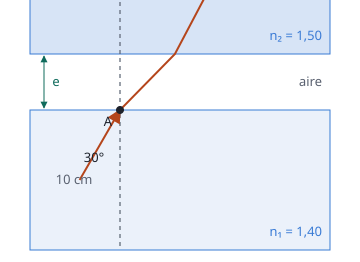

## Enunciado

Dos cristales de grosor 10 cm e índices de refracción $n_1 = 1{,}40$ y $n_2 = 1{,}50$, están separados por una capa de aire de espesor desconocido, $e$. Un rayo de luz incide por el punto A desde el cristal 1 hacia el cristal 2 atravesando la capa de aire que los separa con un ángulo de incidencia de 30° y saliendo por el punto B tal y como se indica en la figura. Si la distancia horizontal entre los puntos A y B es $d = 9{,}2\ \mathrm{cm}$, determine:

1. El espesor, $e$, de la capa de aire situada entre ambos cristales.
2. El tiempo que tarda el rayo de luz en llegar desde el punto A hasta el punto B.

**Datos:** Velocidad de la luz en el vacío, $c = 3\cdot 10^{8}\ \mathrm{m\,s^{-1}}$; Índice de refracción del aire, $n = 1$.

## Datos

- Ángulo de incidencia en A (dentro del cristal 1): 30°
- Grosor del cristal 2: 10 cm
- Desplazamiento horizontal total de A a B: $d = 9{,}2\ \mathrm{cm}$

## Planteamiento

De A a B el rayo recorre dos tramos rectos: uno en el aire y otro en el cristal 2. En cada uno avanza horizontalmente (espesor)·(tangente del ángulo con la normal). La suma de los dos avances es $d$, y la única incógnita es el espesor del aire. Los ángulos salen de aplicar dos veces la ley de Snell.

## Resolución

### a) Espesor de la capa de aire

**Del cristal 1 al aire (punto A).**

$$n_1\operatorname{sen}30^\circ = 1\cdot\operatorname{sen}\theta
\quad\Longrightarrow\quad
\operatorname{sen}\theta = 1{,}40\cdot 0{,}5 = 0{,}700
\quad\Longrightarrow\quad
\theta = 44{,}4^\circ$$

**Del aire al cristal 2.** Las caras son paralelas, así que el rayo llega con el mismo ángulo $\theta$:

$$1\cdot\operatorname{sen}\theta = n_2\operatorname{sen}\theta'
\quad\Longrightarrow\quad
\operatorname{sen}\theta' = \frac{0{,}700}{1{,}50} = 0{,}467
\quad\Longrightarrow\quad
\theta' = 27{,}8^\circ$$

**Avance horizontal en el cristal 2.**

$$d_2 = 10\tan 27{,}8^\circ = 5{,}28\ \mathrm{cm}$$

**Avance en el aire y espesor.** El resto, $9{,}2 - 5{,}28 = 3{,}92\ \mathrm{cm}$, se recorre en la capa de aire:

$$e\tan\theta = 3{,}92
\quad\Longrightarrow\quad
e = \frac{3{,}92}{\tan 44{,}4^\circ} = 4{,}00\ \mathrm{cm}$$

### b) Tiempo de A a B

Longitud de cada tramo (hipotenusas) y tiempo, recordando que en el cristal la luz va a $c/n_2$:

$$s_1 = \frac{e}{\cos\theta} = \frac{4{,}00}{\cos 44{,}4^\circ} = 5{,}60\ \mathrm{cm}
\quad\Longrightarrow\quad
t_1 = \frac{s_1}{c} = 1{,}87\cdot 10^{-10}\ \mathrm{s}$$

$$s_2 = \frac{10}{\cos 27{,}8^\circ} = 11{,}3\ \mathrm{cm}
\quad\Longrightarrow\quad
t_2 = \frac{s_2\,n_2}{c} = 5{,}65\cdot 10^{-10}\ \mathrm{s}$$

$$t = t_1 + t_2 = 7{,}52\cdot 10^{-10}\ \mathrm{s}$$

## Errores típicos

- Aplicar Snell directamente del cristal 1 al cristal 2 y olvidar que en el aire el rayo va con otro ángulo. (El ángulo final $\theta'$ sale igual, pero el del aire hace falta.)
- Usar el seno en lugar de la tangente para el avance horizontal.
- Calcular el tiempo en el cristal con la velocidad $c$.
- Olvidar pasar los centímetros a metros en el tiempo.
