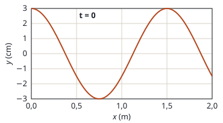

## Enunciado

En la figura se representa la elongación de una onda transversal en el instante $t = 0$ en función de la posición $x$. La onda se propaga en el sentido negativo del eje $x$. Sabiendo que el tiempo que tarda el punto situado en $x = 0$ desde que sale de su posición inicial ($t = 0$) hasta que vuelve a la misma es de 0,5 s, determine:

1. La longitud de onda y la velocidad de propagación.
2. La expresión matemática de la onda.

## Datos

- De la gráfica: amplitud $A = 3\ \mathrm{cm}$; el perfil se repite cada 1,5 m; en $x = 0$, $t = 0$ la elongación es $+A$
- El punto $x = 0$ parte de un extremo ($+A$) y tarda 0,5 s en volver a él: eso es una oscilación completa, $T = 0{,}5\ \mathrm{s}$
- Sentido de propagación: $-x$

## Planteamiento

La gráfica es una «foto» de la onda: da la amplitud y la longitud de onda. El periodo lo da el enunciado, con una frase que hay que interpretar: como el punto empieza en un máximo, volver a su posición inicial exige una oscilación entera. Una onda que viaja hacia las $x$ negativas lleva el **mismo signo** en $\omega t$ y en $kx$.

## Resolución

### a) Longitud de onda y velocidad de propagación

Distancia entre dos máximos consecutivos de la gráfica:

$$\lambda = 1{,}50\ \mathrm{m}$$

$$v = \frac{\lambda}{T} = \frac{1{,}50}{0{,}5} = 3{,}00\ \mathrm{m\,s^{-1}}$$

### b) Expresión de la onda

$$\omega = \frac{2\pi}{T} = 4\pi\ \mathrm{rad\,s^{-1}}
\qquad
k = \frac{2\pi}{\lambda} = \frac{4\pi}{3}\ \mathrm{rad\,m^{-1}}$$

Forma general para propagación hacia $-x$:

$$y(x,t) = A\operatorname{sen}(\omega t + kx + \varphi_0)$$

Condición inicial, $y(0,0) = +A$:

$$A\operatorname{sen}\varphi_0 = A
\quad\Longrightarrow\quad
\varphi_0 = \frac{\pi}{2}$$

$$y(x,t) = 3\operatorname{sen}\left(4\pi t + \frac{4\pi}{3}\,x + \frac{\pi}{2}\right)\ \mathrm{cm}$$

con $x$ en metros y $t$ en segundos. Es lo mismo que $y = 3\cos\left(4\pi t + \tfrac{4\pi}{3}x\right)$ cm.

**Comprobación:** en $x = 0{,}75\ \mathrm{m}$, $t = 0$, la fase es $\pi + \pi/2$ y $y = -3\ \mathrm{cm}$, como en la gráfica.

## Errores típicos

- Poner signo menos entre $\omega t$ y $kx$: esa onda iría hacia $+x$.
- Leer la longitud de onda entre un máximo y un mínimo (0,75 m).
- Tomar 0,5 s como medio periodo. Lo sería si el punto partiera de $y = 0$.
