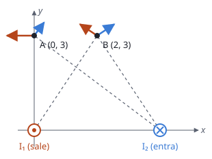

## Enunciado

Dos hilos indefinidos paralelos al eje $z$ llevan intensidades iguales $I_1 = I_2 = 2\ \mathrm{A}$ y cortan el plano $xy$ en los puntos $(0, 0)\ \mathrm{m}$ y $(4, 0)\ \mathrm{m}$, respectivamente. Si el primer hilo, el que pasa por el origen, lleva su intensidad en el sentido positivo del eje $z$ y el segundo en sentido negativo, determine el campo magnético en los puntos:

1. A $(0, 3)\ \mathrm{m}$.
2. B $(2, 3)\ \mathrm{m}$.

**Dato:** Permeabilidad magnética del vacío, $\mu_0 = 4\pi\cdot 10^{-7}\ \mathrm{T\,m\,A^{-1}}$.

## Datos

- Hilo 1 en $(0, 0)$, corriente hacia $+z$ (sale del papel); hilo 2 en $(4, 0)\ \mathrm{m}$, corriente hacia $-z$ (entra)
- $I_1 = I_2 = 2\ \mathrm{A}$
- Distancias: de A, 3 m al hilo 1 y $\sqrt{4^2 + 3^2} = 5\ \mathrm{m}$ al hilo 2; de B, $\sqrt{2^2 + 3^2} = \sqrt{13}\ \mathrm{m}$ a los dos

## Planteamiento

El campo de cada hilo vale $B = \mu_0 I/(2\pi d)$, es perpendicular a la línea hilo-punto y gira en sentido antihorario alrededor de una corriente saliente y horario alrededor de una entrante. Se obtiene cada vector y se suman. El punto B está en la mediatriz entre los hilos, y la simetría simplifica el resultado.

## Resolución

### a) Campo en A (0, 3) m

**Hilo 1** (saliente, A está justo encima): el giro antihorario apunta en A hacia la izquierda.

$$B_1 = \frac{4\pi\cdot 10^{-7}\cdot 2}{2\pi\cdot 3} = 1{,}33\cdot 10^{-7}\ \mathrm{T}
\qquad
\vec B_1 = -1{,}33\cdot 10^{-7}\,\vec i\ \mathrm{T}$$

**Hilo 2** (entrante, a 5 m):

$$B_2 = \frac{4\pi\cdot 10^{-7}\cdot 2}{2\pi\cdot 5} = 8{,}00\cdot 10^{-8}\ \mathrm{T}$$

El vector del hilo 2 a A es $(-4, 3)/5$. El campo es perpendicular a él, y con giro horario apunta hacia la derecha y hacia arriba: dirección $(3, 4)/5$.

$$\vec B_2 = 8{,}00\cdot 10^{-8}\left(\frac35\,\vec i + \frac45\,\vec j\right) = (4{,}80\cdot 10^{-8}\,\vec i + 6{,}40\cdot 10^{-8}\,\vec j)\ \mathrm{T}$$

**Total.**

$$\vec B(A) = (-8{,}53\cdot 10^{-8}\,\vec i + 6{,}40\cdot 10^{-8}\,\vec j)\ \mathrm{T}$$

### b) Campo en B (2, 3) m

Los dos hilos están a $\sqrt{13}\ \mathrm{m}$ y los módulos son iguales:

$$B_1 = B_2 = \frac{4\pi\cdot 10^{-7}\cdot 2}{2\pi\sqrt{13}} = 1{,}11\cdot 10^{-7}\ \mathrm{T}$$

- Hilo 1: vector al punto $(2, 3)/\sqrt{13}$; giro antihorario, dirección $(-3, 2)/\sqrt{13}$.
- Hilo 2: vector al punto $(-2, 3)/\sqrt{13}$; giro horario, dirección $(3, 2)/\sqrt{13}$.

Las componentes $x$ se cancelan y las $y$ se suman:

$$\vec B(B) = 2\cdot 1{,}11\cdot 10^{-7}\cdot\frac{2}{\sqrt{13}}\,\vec j = 1{,}23\cdot 10^{-7}\,\vec j\ \mathrm{T}$$

La solución orientativa oficial plantea esta misma expresión, pero escribe como resultado $1{,}28\cdot 10^{-7}\ \mathrm{T}$. La operación da $1{,}23\cdot 10^{-7}$; parece una errata del documento oficial.

## Errores típicos

- Dibujar los campos apuntando hacia los hilos o alejándose de ellos.
- Usar el mismo sentido de giro para los dos hilos, cuando las corrientes son opuestas.
- En B, sumar los módulos sin proyectar.
