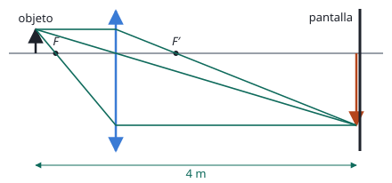

## Enunciado

Un objeto se encuentra a una distancia de 4 m de una pantalla. Entre el objeto y la pantalla se coloca una lente delgada que produce una imagen en la pantalla 3 veces mayor que el objeto.

1. Calcule la distancia entre el objeto y la lente, así como su distancia focal.
2. Realice el diagrama de rayos.

## Datos

- Distancia objeto-pantalla: 4 m. Con el objeto a la izquierda ($s < 0$) y la pantalla a la derecha ($s' > 0$): $s' - s = 4\ \mathrm{m}$
- La imagen se recoge en una pantalla: es **real**, y por tanto invertida. Aumento $M = -3$

## Planteamiento

Que la imagen se forme sobre una pantalla dice que es real. Una sola lente solo da imágenes reales invertidas, lo que fija el signo del aumento y, de paso, que la lente es convergente. Con el aumento y la distancia total se obtienen las dos posiciones, y con ellas la focal.

## Resolución

### a) Distancia objeto-lente y distancia focal

$$M = \frac{s'}{s} = -3
\quad\Longrightarrow\quad
s' = -3\,s$$

$$s' - s = 4
\quad\Longrightarrow\quad
-3s - s = 4
\quad\Longrightarrow\quad
s = -1{,}00\ \mathrm{m}$$

El objeto está a 1 m de la lente y la pantalla a $s' = 3\ \mathrm{m}$.

$$\frac{1}{f'} = \frac{1}{s'} - \frac{1}{s} = \frac13 + \frac11 = \frac43
\quad\Longrightarrow\quad
f' = 0{,}750\ \mathrm{m}$$

Focal positiva: lente convergente. El objeto queda entre $f'$ y $2f'$ (entre 0,75 y 1,5 m), la zona en la que la imagen es real y mayor.

### b) Diagrama de rayos

Desde el extremo del objeto:

- el rayo paralelo al eje sale pasando por el foco imagen $F'$;
- el rayo que pasa por el centro de la lente no se desvía;
- el rayo que pasa por el foco objeto $F$ sale paralelo al eje.

Los tres se cortan sobre la pantalla, a 3 m de la lente.

## Errores típicos

- Tomar $M = +3$: daría una imagen virtual, que no se puede recoger en una pantalla.
- Escribir $s + s' = 4$ sin tener en cuenta que $s$ es negativa.
- Dar la distancia objeto-lente como 3 m (confundir $s$ con $s'$).
