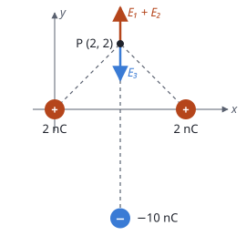

## Enunciado

Dos cargas de 2 nC cada una están fijas en los puntos $(0, 0)\ \mathrm{m}$ y $(4, 0)\ \mathrm{m}$ del plano $xy$.

1. Determine el valor de una carga $Q$ si para traerla desde el infinito hasta el punto $(2, 2)\ \mathrm{m}$ el campo hace un trabajo de $1{,}27\cdot 10^{-7}\ \mathrm{J}$.
2. Indique el punto donde habría que colocar una carga de $-10\ \mathrm{nC}$ para que la fuerza neta sobre la carga $Q$ fuese cero.

**Dato:** Constante de la ley de Coulomb, $K = 9\cdot 10^{9}\ \mathrm{N\,m^2\,C^{-2}}$.

## Datos

- $q_1 = q_2 = 2\cdot 10^{-9}\ \mathrm{C}$; punto P$(2, 2)\ \mathrm{m}$, a $r = \sqrt{2^2 + 2^2} = \sqrt 8\ \mathrm{m}$ de las dos
- Trabajo del campo al traer $Q$ desde el infinito: $W = 1{,}27\cdot 10^{-7}\ \mathrm{J}$
- Tercera carga: $q_3 = -10\cdot 10^{-9}\ \mathrm{C}$

## Planteamiento

El trabajo del campo al llevar una carga de un punto a otro es $W = Q\,(V_\text{inicial} - V_\text{final})$. Desde el infinito, $W = -Q\,V_P$: con el potencial en P se despeja $Q$. Que el campo haga trabajo positivo al acercar la carga a dos cargas positivas ya indica que $Q$ será negativa (es atraída).

La fuerza sobre $Q$ es $Q\vec E$: se anula si el **campo total** en P es cero, sea cual sea $Q$. Hay que colocar $q_3$ donde su campo en P cancele el de las otras dos.

## Resolución

### a) Valor de la carga Q

$$V_P = 2\,K\,\frac{q_1}{r} = \frac{2\cdot 9\cdot 10^{9}\cdot 2\cdot 10^{-9}}{\sqrt 8} = 12{,}7\ \mathrm{V}$$

$$W = -Q\,V_P
\quad\Longrightarrow\quad
Q = -\frac{W}{V_P} = -\frac{1{,}27\cdot 10^{-7}}{12{,}7} = -9{,}98\cdot 10^{-9}\ \mathrm{C}$$

Prácticamente $-10\ \mathrm{nC}$.

### b) Posición de la carga de −10 nC

**Campo de $q_1$ y $q_2$ en P.** Por simetría las componentes horizontales se cancelan y las verticales, hacia arriba, se suman. Cada campo forma 45° con el eje $x$:

$$E_{12} = 2\,K\,\frac{q_1}{r^2}\operatorname{sen}45^\circ = 2\cdot\frac{9\cdot 10^{9}\cdot 2\cdot 10^{-9}}{8}\cdot\frac{\sqrt 2}{2} = 3{,}18\ \mathrm{N\,C^{-1}}$$

$$\vec E_{12} = 3{,}18\,\vec j\ \ \mathrm{N\,C^{-1}}$$

**Campo de $q_3$.** Tiene que valer $-3{,}18\,\vec j$: vertical y hacia abajo. El campo de una carga negativa apunta **hacia ella**, así que $q_3$ debe estar justo debajo de P, en la recta $x = 2\ \mathrm{m}$, a una distancia $d$ tal que:

$$K\,\frac{|q_3|}{d^2} = 3{,}18
\quad\Longrightarrow\quad
d = \sqrt{\frac{9\cdot 10^{9}\cdot 10\cdot 10^{-9}}{3{,}18}} = 5{,}32\ \mathrm{m}$$

Su ordenada es $y = 2 - 5{,}32 = -3{,}32\ \mathrm{m}$. La carga debe colocarse en el punto $(2;\ -3{,}32)\ \mathrm{m}$.

## Errores típicos

- Escribir $W = Q\,V_P$ y obtener $Q$ positiva.
- Colocar $q_3$ encima de P: su campo iría hacia arriba y se sumaría.
- Dar como respuesta la distancia (5,32 m) en lugar de las coordenadas del punto.
- Sumar los módulos de los campos de $q_1$ y $q_2$ sin proyectar.
