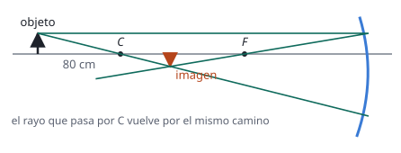

## Enunciado

Un espejo esférico cóncavo de 60 cm de radio de curvatura tiene situado a 80 cm frente a él y sobre su eje óptico un objeto de 5 cm de altura.

1. Describa y dibuje las trayectorias de los rayos que salen hacia el espejo desde el extremo superior del objeto, en el caso de que el rayo salga paralelo al eje óptico y en el caso de que el rayo pase por el centro de curvatura del espejo.
2. Calcule la posición y el tamaño de la imagen del objeto producida por el espejo.

## Datos

Con el criterio de signos DIN (origen en el vértice del espejo, positivo hacia la derecha), el objeto y el centro de curvatura de un espejo cóncavo están a la izquierda:

- $R = -60\ \mathrm{cm}$, luego $f = R/2 = -30\ \mathrm{cm}$
- $s = -80\ \mathrm{cm}$; $y = 5\ \mathrm{cm}$

## Planteamiento

Hay dos rayos cuya trayectoria tras reflejarse se conoce sin cálculos: el paralelo al eje, que va al foco, y el que pasa por el centro de curvatura, que llega perpendicular al espejo y vuelve sobre sus pasos. Donde se cortan está la imagen. Las ecuaciones del espejo dan los valores exactos.

## Resolución

### a) Trayectoria de los rayos

- **Rayo paralelo al eje óptico.** Tras reflejarse en el espejo pasa por el foco $F$, que está a 30 cm del espejo, a mitad de camino entre el vértice y el centro de curvatura.
- **Rayo que pasa por el centro de curvatura $C$.** Sigue un radio de la esfera, incide perpendicularmente sobre el espejo y se refleja volviendo por el mismo camino.

Los dos rayos reflejados se cortan delante del espejo, entre $C$ y $F$: la imagen es real, invertida y menor que el objeto.

### b) Posición y tamaño de la imagen

$$\frac{1}{s'} + \frac{1}{s} = \frac{1}{f}
\quad\Longrightarrow\quad
\frac{1}{s'} = \frac{1}{-30} - \frac{1}{-80} = \frac{-8 + 3}{240}
\quad\Longrightarrow\quad
s' = -48{,}0\ \mathrm{cm}$$

La imagen se forma 48 cm delante del espejo. En un espejo, $s' < 0$ significa imagen real.

$$y' = -\frac{s'}{s}\,y = -\frac{-48}{-80}\cdot 5 = -3{,}00\ \mathrm{cm}$$

Mide 3 cm y está invertida, tal como muestra el trazado.

## Errores típicos

- Tomar el radio o la focal como positivos. En un espejo cóncavo, con el criterio DIN, son negativos.
- Usar la focal igual al radio.
- Aplicar las fórmulas de las lentes ($1/s' - 1/s$ y $M = s'/s$).
- Interpretar $s' < 0$ como imagen virtual, por analogía con las lentes.
