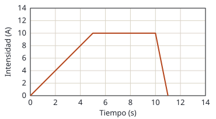

## Enunciado

Por un solenoide infinitamente largo de 250 espiras por metro, cuyo eje coincide con el eje $z$, circula una corriente eléctrica variable en el tiempo según se muestra en la figura.

1. Determine el campo magnético en su interior para $t = 3\ \mathrm{s}$ y $t = 8\ \mathrm{s}$.
2. Si en el interior del solenoide hay una espira cuadrada de lado $a = 3\ \mathrm{cm}$ y resistencia eléctrica de $5\ \Omega$, cuya superficie es perpendicular al eje $z$, calcule la intensidad de corriente inducida en la espira en $t = 3\ \mathrm{s}$ y en $t = 8\ \mathrm{s}$.

**Dato:** Permeabilidad magnética del vacío, $\mu_0 = 4\pi\cdot 10^{-7}\ \mathrm{T\,m\,A^{-1}}$.

## Datos

- Espiras por unidad de longitud: $n = 250\ \mathrm{m^{-1}}$
- De la gráfica: en $t = 3\ \mathrm{s}$ la corriente vale 6 A y está **subiendo** a razón de $10/5 = 2\ \mathrm{A\,s^{-1}}$; en $t = 8\ \mathrm{s}$ vale 10 A y es **constante**
- Espira: superficie $S = a^2 = (0{,}03)^2 = 9{,}0\cdot 10^{-4}\ \mathrm{m^2}$; $R = 5\ \Omega$

## Planteamiento

El campo dentro de un solenoide largo es uniforme, paralelo al eje y proporcional a la corriente: $B = \mu_0 n I$. Para el campo importa **cuánto vale** la corriente en cada instante.

La espira es perpendicular al eje, así que el campo la atraviesa de lleno y el flujo es $B\,S$. Para la corriente inducida importa **cómo cambia** ese flujo, es decir, la pendiente de la gráfica.

## Resolución

### a) Campo magnético en el interior

$$B(3\ \mathrm{s}) = \mu_0\,n\,I = 4\pi\cdot 10^{-7}\cdot 250\cdot 6 = 1{,}88\cdot 10^{-3}\ \mathrm{T}$$

$$B(8\ \mathrm{s}) = 4\pi\cdot 10^{-7}\cdot 250\cdot 10 = 3{,}14\cdot 10^{-3}\ \mathrm{T}$$

En los dos casos, dirigido a lo largo del eje $z$.

### b) Corriente inducida en la espira

Flujo a través de la espira y fem inducida:

$$\Phi = B\,S = \mu_0\,n\,I\,a^2
\quad\Longrightarrow\quad
|\varepsilon| = \left|\frac{\mathrm{d}\Phi}{\mathrm{d}t}\right| = \mu_0\,n\,a^2\left|\frac{\mathrm{d}I}{\mathrm{d}t}\right|$$

**En $t = 3\ \mathrm{s}$**, con $\mathrm{d}I/\mathrm{d}t = 2\ \mathrm{A\,s^{-1}}$:

$$|\varepsilon| = 4\pi\cdot 10^{-7}\cdot 250\cdot 9{,}0\cdot 10^{-4}\cdot 2 = 5{,}65\cdot 10^{-7}\ \mathrm{V}$$

$$I_\text{ind} = \frac{|\varepsilon|}{R} = \frac{5{,}65\cdot 10^{-7}}{5} = 1{,}13\cdot 10^{-7}\ \mathrm{A}$$

**En $t = 8\ \mathrm{s}$** la corriente del solenoide no cambia, el flujo es constante y no hay fem:

$$I_\text{ind} = 0$$

Justo cuando el campo es mayor, la corriente inducida es nula.

La solución orientativa oficial plantea la misma expresión para $t = 3\ \mathrm{s}$ pero escribe $1{,}11\cdot 10^{-7}\ \mathrm{A}$; la operación da $1{,}13\cdot 10^{-7}$.

## Errores típicos

- Calcular la fem en $t = 8\ \mathrm{s}$ porque «hay campo». Sin variación de flujo no hay inducción.
- Usar el valor de la corriente (6 A) en lugar de su pendiente (2 A/s) en la fem.
- Tomar como superficie de la espira $0{,}03\ \mathrm{m^2}$ sin elevar al cuadrado.
