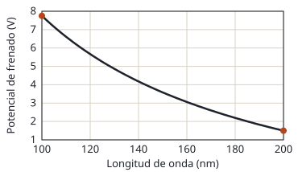

## Enunciado

En la gráfica adjunta se representa el potencial de frenado para el cobre cuando se ilumina con fotones de longitudes de onda entre 100 y 200 nm.

1. Utilice los datos de la gráfica para determinar el valor de la constante de Planck y el trabajo de extracción para el cobre.
2. Considere un electrón emitido con energía cinética máxima por el cobre cuando es irradiado con luz de longitud de onda de 100 nm. ¿Qué incremento de energía cinética experimentaría si tras ser emitido fuese acelerado hasta una velocidad igual a $0{,}8\,c$?

**Datos:** Velocidad de la luz en el vacío, $c = 3\cdot 10^{8}\ \mathrm{m\,s^{-1}}$; Valor absoluto de la carga del electrón, $e = 1{,}6\cdot 10^{-19}\ \mathrm{C}$; Masa en reposo del electrón, $m_e = 9{,}1\cdot 10^{-31}\ \mathrm{kg}$.

## Datos

Los dos puntos de los extremos de la gráfica, que son los que mejor se leen:

- $\lambda_1 = 100\ \mathrm{nm} = 1{,}0\cdot 10^{-7}\ \mathrm{m}$: $V_1 = 7{,}75\ \mathrm{V}$
- $\lambda_2 = 200\ \mathrm{nm} = 2{,}0\cdot 10^{-7}\ \mathrm{m}$: $V_2 = 1{,}5\ \mathrm{V}$

## Planteamiento

La ecuación de Einstein con el potencial de frenado, $hc/\lambda = W_0 + eV$, escrita para dos puntos de la gráfica, es un sistema de dos ecuaciones con dos incógnitas, $h$ y $W_0$. Restándolas se elimina $W_0$.

El segundo apartado mezcla dos mundos: el electrón sale del metal con unos pocos eV, y después se le lleva a $0{,}8c$, donde hay que usar la energía cinética relativista. La diferencia entre ambas es enorme.

## Resolución

### a) Constante de Planck y trabajo de extracción

$$\frac{h\,c}{\lambda_1} = W_0 + e\,V_1 \qquad \frac{h\,c}{\lambda_2} = W_0 + e\,V_2
\quad\Longrightarrow\quad
h\,c\left(\frac{1}{\lambda_1} - \frac{1}{\lambda_2}\right) = e\,(V_1 - V_2)$$

$$\frac{1}{\lambda_1} - \frac{1}{\lambda_2} = 1{,}0\cdot 10^{7} - 0{,}5\cdot 10^{7} = 5{,}0\cdot 10^{6}\ \mathrm{m^{-1}}$$

$$h = \frac{1{,}6\cdot 10^{-19}\cdot (7{,}75 - 1{,}5)}{3\cdot 10^{8}\cdot 5{,}0\cdot 10^{6}} = 6{,}67\cdot 10^{-34}\ \mathrm{J\,s}$$

**Trabajo de extracción**, con el punto de 200 nm:

$$W_0 = \frac{h\,c}{\lambda_2} - e\,V_2 = \frac{6{,}67\cdot 10^{-34}\cdot 3\cdot 10^{8}}{2{,}0\cdot 10^{-7}} - 1{,}6\cdot 10^{-19}\cdot 1{,}5 = 7{,}60\cdot 10^{-19}\ \mathrm{J}$$

$$W_0 = \frac{7{,}60\cdot 10^{-19}}{1{,}6\cdot 10^{-19}} = 4{,}75\ \mathrm{eV}$$

### b) Incremento de energía cinética hasta 0,8c

**Energía cinética inicial.** Con luz de 100 nm el potencial de frenado es 7,75 V:

$$E_{c1} = e\,V_1 = 7{,}75\ \mathrm{eV} = 1{,}24\cdot 10^{-18}\ \mathrm{J}$$

**Energía cinética a $0{,}8c$**, relativista:

$$\gamma = \frac{1}{\sqrt{1 - 0{,}8^2}} = \frac{1}{0{,}6} = 1{,}667$$

$$E_{c2} = (\gamma - 1)\,m_e\,c^2 = 0{,}667\cdot 9{,}1\cdot 10^{-31}\cdot (3\cdot 10^{8})^2 = 5{,}46\cdot 10^{-14}\ \mathrm{J}$$

**Incremento.**

$$\Delta E_c = E_{c2} - E_{c1} = 5{,}46\cdot 10^{-14} - 1{,}24\cdot 10^{-18} = 5{,}46\cdot 10^{-14}\ \mathrm{J}$$

Son 0,34 MeV. La energía inicial es cuarenta mil veces menor y no cambia ninguna de las cifras del resultado.

## Errores típicos

- Tratar la gráfica como una recta: frente a la longitud de onda es una curva (sería recta frente a la frecuencia).
- Restar las longitudes de onda en lugar de sus inversos.
- Usar $\tfrac12 m v^2$ a $0{,}8c$: da $2{,}6\cdot 10^{-14}\ \mathrm{J}$, menos de la mitad.
- Usar el valor de $h$ de memoria cuando se pide obtenerlo de la gráfica.
