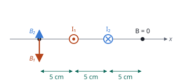

## Enunciado

Un hilo conductor de longitud indefinida se extiende a lo largo del eje $z$. Otro hilo de longitud indefinida paralelo al primero pasa por el punto $(5, 0, 0)\ \mathrm{cm}$. Los dos hilos se repelen con una fuerza por unidad de longitud de $5\cdot 10^{-5}\ \mathrm{N\,m^{-1}}$. El campo magnético total se anula a lo largo de la recta $x = +10\ \mathrm{cm}$ en el plano $xz$.

1. Explique si las corrientes en los hilos son paralelas o antiparalelas y calcule su magnitud.
2. Determine el módulo del campo magnético en el punto $(-5, 0, 0)\ \mathrm{cm}$.

**Dato:** Permeabilidad magnética del vacío, $\mu_0 = 4\pi\cdot 10^{-7}\ \mathrm{T\,m\,A^{-1}}$.

## Datos

- Hilo 1 en $x = 0$; hilo 2 en $x = 5\ \mathrm{cm}$; separación $d = 0{,}05\ \mathrm{m}$
- Fuerza por unidad de longitud: $F/L = 5\cdot 10^{-5}\ \mathrm{N\,m^{-1}}$, repulsiva
- Campo nulo en $x = 10\ \mathrm{cm}$: a 10 cm del hilo 1 y a 5 cm del hilo 2

## Planteamiento

Hay dos incógnitas, las dos intensidades, y dos datos. El punto de campo nulo da la **relación** entre las corrientes; la fuerza da su **producto**.

Dos hilos paralelos se atraen si las corrientes van en el mismo sentido y se repelen si van en sentidos opuestos. El punto de campo nulo lo confirma: con corrientes opuestas, los campos se suman entre los hilos y se restan fuera, y el campo solo puede anularse fuera, del lado del hilo de menor corriente.

## Resolución

### a) Sentido y valor de las corrientes

**Sentido.** Los hilos se repelen, luego las corrientes son **antiparalelas**.

**Relación entre las corrientes.** En $x = 10\ \mathrm{cm}$ los dos campos tienen el mismo módulo:

$$\frac{\mu_0\,I_1}{2\pi\cdot 0{,}10} = \frac{\mu_0\,I_2}{2\pi\cdot 0{,}05}
\quad\Longrightarrow\quad
I_1 = 2\,I_2$$

**Fuerza entre los hilos.**

$$\frac{F}{L} = \frac{\mu_0\,I_1\,I_2}{2\pi\,d} = \frac{\mu_0\cdot 2\,I_2^2}{2\pi\,d}
\quad\Longrightarrow\quad
I_2 = \sqrt{\frac{\pi\,d}{\mu_0}\cdot\frac{F}{L}}$$

$$I_2 = \sqrt{\frac{\pi\cdot 0{,}05\cdot 5\cdot 10^{-5}}{4\pi\cdot 10^{-7}}} = 2{,}50\ \mathrm{A}
\qquad
I_1 = 2\,I_2 = 5{,}00\ \mathrm{A}$$

### b) Campo en (−5, 0, 0) cm

El punto está a 5 cm del hilo 1 y a 10 cm del hilo 2, fuera del espacio entre ellos y del mismo lado respecto a ambos. Con corrientes opuestas, allí los campos tienen sentidos contrarios y se restan:

$$B_1 = \frac{4\pi\cdot 10^{-7}\cdot 5}{2\pi\cdot 0{,}05} = 2{,}00\cdot 10^{-5}\ \mathrm{T}
\qquad
B_2 = \frac{4\pi\cdot 10^{-7}\cdot 2{,}5}{2\pi\cdot 0{,}10} = 5{,}0\cdot 10^{-6}\ \mathrm{T}$$

$$B = B_1 - B_2 = 1{,}50\cdot 10^{-5}\ \mathrm{T}$$

## Errores típicos

- Colocar el punto de campo nulo entre los hilos. Con corrientes opuestas, ahí los campos se suman.
- Usar las mismas distancias para los dos hilos en $x = 10\ \mathrm{cm}$.
- Sumar los campos en el apartado b.
- Dejar las distancias en centímetros.
