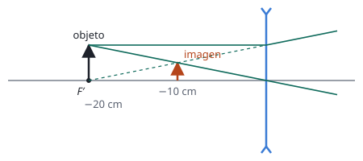

## Enunciado

Un objeto de 4 mm de altura está situado 20 cm a la izquierda de una lente delgada. La imagen que se forma es derecha y tiene una altura de 2 mm.

1. Calcule la potencia de la lente e indique si es convergente o divergente.
2. Elabore el trazado de rayos correspondiente a la situación descrita.

## Datos

Con el criterio de signos DIN:

- Objeto: $y = 4\ \mathrm{mm}$, $s = -20\ \mathrm{cm} = -0{,}20\ \mathrm{m}$
- Imagen derecha: $y' = +2\ \mathrm{mm}$, luego $M = +\dfrac12$

## Planteamiento

El aumento da la posición de la imagen, y con las dos posiciones la ecuación de la lente da la focal. La potencia es el inverso de la focal **en metros**. Antes de calcular ya se puede anticipar el resultado: una imagen derecha y más pequeña que el objeto solo la da una lente divergente (una convergente da imágenes derechas únicamente cuando son mayores, como una lupa).

## Resolución

### a) Potencia y tipo de lente

$$M = \frac{y'}{y} = \frac{s'}{s} = \frac12
\quad\Longrightarrow\quad
s' = \frac{s}{2} = -0{,}10\ \mathrm{m}$$

La imagen está 10 cm a la izquierda de la lente, en el mismo lado que el objeto: es virtual.

$$P = \frac{1}{f'} = \frac{1}{s'} - \frac{1}{s} = \frac{1}{-0{,}10} - \frac{1}{-0{,}20} = -10 + 5 = -5{,}00\ \mathrm{D}$$

Potencia negativa: la lente es **divergente**, con focal $f' = 1/P = -0{,}20\ \mathrm{m}$.

### b) Trazado de rayos

El foco imagen $F'$ de una lente divergente está a su izquierda, a 20 cm: coincide con la posición del objeto. Desde el extremo del objeto:

- el rayo paralelo al eje se refracta alejándose del eje, como si viniera de $F'$ (prolongación en línea de puntos);
- el rayo que pasa por el centro de la lente no se desvía.

La prolongación del primero corta al segundo a 10 cm de la lente y a la mitad de la altura: ahí está la imagen, virtual, derecha y menor.

## Errores típicos

- Calcular la potencia con la focal en centímetros: saldría $-0{,}05$ en lugar de $-5$ dioptrías.
- Tomar $M = -\tfrac12$ aunque el enunciado dice que la imagen es derecha.
- Dibujar el foco imagen a la derecha, como en una lente convergente.
- Pasar los milímetros de las alturas a metros innecesariamente y equivocarse: solo importa su cociente.
