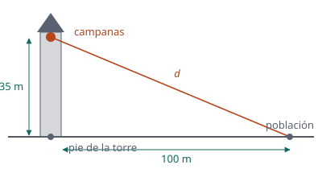

## Enunciado

El campanario de una iglesia medieval, situado a 35 m de altura, consta de 4 campanas. Cada una de ellas emite 10 mW de potencia sonora tras ser golpeada. Por otro lado, el límite de contaminación acústica en ese municipio está establecido en 55 dB.

1. Determine el nivel de intensidad sonora que percibe una persona parada al pie de la torre del campanario cuando se toca una sola campana.
2. ¿Podrán tocar las cuatro campanas a la vez si no se quiere sobrepasar el límite de contaminación acústica y la población está situada a más de 100 metros de la iglesia?

**Dato:** Intensidad umbral, $I_0 = 1\cdot 10^{-12}\ \mathrm{W\,m^{-2}}$.

## Datos

- Potencia de cada campana: $P = 10\ \mathrm{mW} = 1{,}0\cdot 10^{-2}\ \mathrm{W}$
- Altura del campanario: $H = 35\ \mathrm{m}$
- Distancia horizontal mínima a la población: $D = 100\ \mathrm{m}$

## Planteamiento

Las campanas son focos puntuales: la intensidad a una distancia $r$ es $P/(4\pi r^2)$. La persona al pie de la torre está justo debajo, a 35 m. La población está más lejos: su distancia a las campanas es la hipotenusa del triángulo de catetos 35 m y 100 m. Con cuatro campanas se suman las potencias (o las intensidades), nunca los decibelios.

El caso más desfavorable es el punto de la población más cercano, a 100 m: si allí no se supera el límite, tampoco más lejos.

## Resolución

### a) Una campana, al pie de la torre

$$I = \frac{P}{4\pi H^2} = \frac{1{,}0\cdot 10^{-2}}{4\pi\cdot 35^2} = 6{,}50\cdot 10^{-7}\ \mathrm{W\,m^{-2}}$$

$$\beta = 10\log\frac{I}{I_0} = 10\log\frac{6{,}50\cdot 10^{-7}}{1\cdot 10^{-12}} = 58{,}1\ \mathrm{dB}$$

### b) Cuatro campanas, a 100 m de la iglesia

Distancia de las campanas al punto más cercano de la población:

$$d = \sqrt{H^2 + D^2} = \sqrt{35^2 + 100^2} = 106\ \mathrm{m}$$

Intensidad con las cuatro campanas sonando:

$$I = \frac{4\,P}{4\pi d^2} = \frac{4\cdot 1{,}0\cdot 10^{-2}}{4\pi\cdot (35^2 + 100^2)} = 2{,}84\cdot 10^{-7}\ \mathrm{W\,m^{-2}}$$

$$\beta = 10\log\frac{2{,}84\cdot 10^{-7}}{1\cdot 10^{-12}} = 54{,}5\ \mathrm{dB}$$

Es menor que 55 dB: **sí pueden tocar las cuatro campanas a la vez**, aunque por muy poco margen.

Es curioso que cuatro campanas a 106 m suenen menos que una sola a 35 m: multiplicar la potencia por 4 sube el nivel 6 dB, pero triplicar la distancia lo baja 9,6 dB.

## Errores típicos

- Multiplicar por 4 los decibelios de una campana.
- Usar 100 m como distancia a las campanas, olvidando la altura.
- Dejar la potencia en milivatios.
