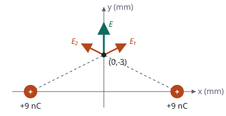

## Enunciado

Dos partículas situadas en los puntos $(-6, 0)\ \mathrm{mm}$ y $(6, 0)\ \mathrm{mm}$ del plano $xy$ poseen cargas iguales de $+9\ \mathrm{nC}$. Obtenga el potencial eléctrico y el campo eléctrico en:

1. El origen de coordenadas.
2. El punto $(0, 3)\ \mathrm{mm}$.

**Dato:** Constante de la ley de Coulomb, $K = 9\cdot 10^{9}\ \mathrm{N\,m^2\,C^{-2}}$.

## Datos

- $Q = 9\cdot 10^{-9}\ \mathrm{C}$ en cada punto; $K\,Q = 81\ \mathrm{N\,m^2\,C^{-1}}$
- Distancia de cada carga al origen: $6\ \mathrm{mm} = 6\cdot 10^{-3}\ \mathrm{m}$
- Distancia de cada carga al punto $(0, 3)$: $d = \sqrt{6^2 + 3^2} = 6{,}71\ \mathrm{mm} = 6{,}71\cdot 10^{-3}\ \mathrm{m}$

## Planteamiento

Los dos puntos están sobre el eje $y$, que es el eje de simetría: equidistan de las dos cargas. El potencial, que es un escalar, vale el doble del de una carga. El campo, que es un vector, se anula en el origen (los dos campos son opuestos) y en el otro punto conserva solo la componente vertical.

Este problema muestra bien que **campo nulo no significa potencial nulo**.

## Resolución

### a) En el origen

**Potencial.**

$$V = 2\,K\,\frac{Q}{r} = \frac{2\cdot 81}{6\cdot 10^{-3}} = 2{,}70\cdot 10^{4}\ \mathrm{V}$$

**Campo.** La carga de la izquierda crea en el origen un campo hacia la derecha y la de la derecha uno igual hacia la izquierda:

$$\vec E = 0$$

### b) En el punto (0, 3) mm

**Potencial.**

$$V = 2\,K\,\frac{Q}{d} = \frac{2\cdot 81}{6{,}71\cdot 10^{-3}} = 2{,}41\cdot 10^{4}\ \mathrm{V}$$

**Campo.** Módulo del campo de cada carga, con $d^2 = 45\ \mathrm{mm^2} = 4{,}5\cdot 10^{-5}\ \mathrm{m^2}$:

$$E_1 = E_2 = K\,\frac{Q}{d^2} = \frac{81}{4{,}5\cdot 10^{-5}} = 1{,}80\cdot 10^{6}\ \mathrm{N\,C^{-1}}$$

Cada campo se aleja de su carga. Las componentes horizontales son opuestas y se cancelan; las verticales se suman. El seno del ángulo que forma cada campo con el eje $x$ es $3/6{,}71$:

$$E_y = 2\cdot 1{,}80\cdot 10^{6}\cdot\frac{3}{6{,}71} = 1{,}61\cdot 10^{6}\ \mathrm{N\,C^{-1}}$$

$$\vec E = 1{,}61\cdot 10^{6}\,\vec j\ \ \mathrm{N\,C^{-1}}$$

## Errores típicos

- Dejar las distancias en milímetros: los resultados cambian en factores de mil y de un millón.
- Decir que el potencial en el origen es cero porque el campo lo es.
- Sumar los módulos de los campos en el punto $(0, 3)$.
- Proyectar con el coseno ($6/6{,}71$) en lugar del seno para la componente vertical.
