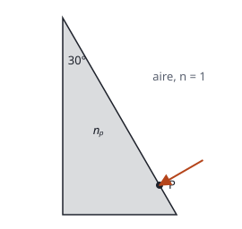
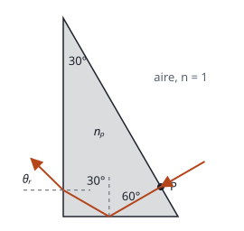

## Enunciado

El prisma de sección triangular mostrado en la figura está hecho de un material con índice de refracción $n_p$. Se halla inmerso en aire, con índice de refracción igual a 1.

1. Determine el índice de refracción $n_p$ si se sabe que el ángulo límite para la reflexión total en el paso del prisma al aire vale 45,58°.
2. Considere un rayo de luz que incide perpendicularmente sobre la superficie del prisma desde el aire, en el punto P. Elabore un diagrama mostrando su recorrido en el interior del prisma hasta que vuelve a emerger al aire, y calcule el ángulo de refracción a la salida.

## Datos

- Ángulo límite prisma-aire: $\theta_L = 45{,}58^\circ$
- Sección del prisma: triángulo rectángulo, con 30° en el vértice superior (entre la cara vertical y la inclinada) y, por tanto, 60° entre la cara inclinada y la base
- El rayo entra perpendicular a la cara inclinada

## Planteamiento

El ángulo límite es el ángulo de incidencia para el que el rayo refractado sale a 90°; de ahí se obtiene el índice.

Para seguir al rayo hay que ir cara por cara, calculando en cada una el ángulo de incidencia **respecto a la normal** y comparándolo con el ángulo límite: si lo supera, hay reflexión total y el rayo no sale; si no, se refracta según la ley de Snell.

## Resolución

### a) Índice de refracción del prisma

$$n_p\operatorname{sen}\theta_L = 1\cdot\operatorname{sen}90^\circ
\quad\Longrightarrow\quad
n_p = \frac{1}{\operatorname{sen}45{,}58^\circ} = 1{,}40$$

### b) Recorrido del rayo y ángulo de salida

**Entrada por P.** El rayo llega perpendicular a la cara inclinada: su ángulo de incidencia es 0° y entra sin desviarse.

**Llegada a la base.** La cara inclinada forma 60° con la base. El rayo es perpendicular a la cara inclinada y la normal a la base es perpendicular a la base; el ángulo entre dos rectas perpendiculares a otras dos es el mismo que forman estas. El rayo incide sobre la base con **60°** respecto a su normal.

Como $60^\circ > 45{,}58^\circ$, hay **reflexión total**: el rayo no sale por la base y se refleja con 60°.

**Llegada a la cara vertical.** El rayo reflejado forma 60° con la normal a la base, que es vertical; forma por tanto 30° con la horizontal, que es la normal a la cara vertical. Incide con **30°**, menor que el ángulo límite: sale al aire.

$$n_p\operatorname{sen}30^\circ = 1\cdot\operatorname{sen}\theta_r
\quad\Longrightarrow\quad
\operatorname{sen}\theta_r = 1{,}40\cdot 0{,}5 = 0{,}700
\quad\Longrightarrow\quad
\theta_r = 44{,}4^\circ$$

El rayo emerge por la cara vertical formando 44,4° con su normal.

## Errores típicos

- Medir los ángulos respecto a las caras en lugar de respecto a las normales.
- Suponer que el rayo sale por la base sin comprobar el ángulo límite.
- Aplicar Snell en la entrada y desviar el rayo: con incidencia normal no hay desviación.
- Invertir el cociente del ángulo límite y obtener un índice menor que 1.
