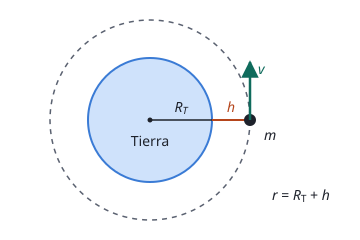

## Enunciado

Un satélite de $1200\ \mathrm{kg}$ describe una órbita circular a $600\ \mathrm{km}$ de altura sobre la superficie de la Tierra. Calcula:

1. La velocidad del satélite y el periodo de la órbita.
2. La energía mínima que hay que suministrarle para que, desde esa órbita, escape del campo gravitatorio terrestre.

**Datos:** $G = 6{,}67\cdot 10^{-11}\ \mathrm{N\,m^2\,kg^{-2}}$; masa de la Tierra, $M_T = 5{,}97\cdot 10^{24}\ \mathrm{kg}$; radio de la Tierra, $R_T = 6{,}37\cdot 10^{6}\ \mathrm{m}$.

## Datos

- Masa del satélite: $m = 1200\ \mathrm{kg}$
- Altura: $h = 600\ \mathrm{km} = 6{,}00\cdot 10^{5}\ \mathrm{m}$
- Radio de la órbita, medido desde el **centro** de la Tierra:

$$r = R_T + h = 6{,}97\cdot 10^{6}\ \mathrm{m}$$

## Planteamiento

En una órbita circular la única fuerza que actúa sobre el satélite es la gravitatoria, y es justo la fuerza centrípeta que necesita para girar. Igualar las dos da la velocidad.

Para el segundo apartado no hacen falta fuerzas: basta con la energía. Escapar significa llegar «al infinito» con velocidad nula, es decir, con energía mecánica cero. Lo que hay que suministrar es la diferencia entre ese cero y la energía mecánica que el satélite tiene en su órbita.

## Resolución

### a) Velocidad y periodo

La fuerza gravitatoria hace de fuerza centrípeta:

$$G\,\frac{M_T\,m}{r^2} = m\,\frac{v^2}{r}$$

La masa del satélite se simplifica (la velocidad orbital no depende de ella) y queda:

$$v = \sqrt{\frac{G\,M_T}{r}}$$

Sustituimos:

$$\begin{aligned}
v &= \sqrt{\frac{6{,}67\cdot 10^{-11}\cdot 5{,}97\cdot 10^{24}}{6{,}97\cdot 10^{6}}} \\[4pt]
  &= 7{,}56\cdot 10^{3}\ \mathrm{m\,s^{-1}}
\end{aligned}$$

El periodo es el tiempo que tarda en dar una vuelta completa, de longitud $2\pi r$, a velocidad constante:

$$\begin{aligned}
T = \frac{2\pi r}{v} &= \frac{2\pi\cdot 6{,}97\cdot 10^{6}}{7{,}56\cdot 10^{3}} \\[4pt]
  &= 5{,}79\cdot 10^{3}\ \mathrm{s}
\end{aligned}$$

Son unos 97 minutos, un valor razonable para un satélite de órbita baja.

### b) Energía para escapar

La energía mecánica en la órbita es la suma de la cinética y la potencial:

$$E_m = \frac{1}{2}\,m\,v^2 - G\,\frac{M_T\,m}{r}$$

Como en la órbita circular $v^2 = G M_T / r$, la energía cinética vale la mitad de la potencial cambiada de signo, y la suma se reduce a:

$$E_m = -\frac{1}{2}\,G\,\frac{M_T\,m}{r}$$

$$\begin{aligned}
E_m &= -\frac{6{,}67\cdot 10^{-11}\cdot 5{,}97\cdot 10^{24}\cdot 1200}{2\cdot 6{,}97\cdot 10^{6}} \\[4pt]
    &= -3{,}43\cdot 10^{10}\ \mathrm{J}
\end{aligned}$$

Es negativa, como corresponde a un cuerpo ligado a la Tierra. Para escapar necesita llegar a $E_m = 0$, así que la energía mínima que hay que darle es:

$$\Delta E = 0 - E_m = 3{,}43\cdot 10^{10}\ \mathrm{J}$$

## Errores típicos

- Usar la altura $h$ en lugar de la distancia al centro, $r = R_T + h$. Es el fallo más frecuente en gravitación.
- Dejar la altura en kilómetros al sustituir.
- En el apartado b, calcular la energía de escape desde la superficie o contar solo la energía potencial. El satélite ya tiene energía cinética por estar en órbita, y por eso hay que partir de su energía mecánica.
