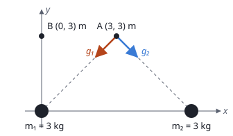

## Enunciado

Sean dos partículas idénticas de masas $m_1 = m_2 = 3\ \mathrm{kg}$, situadas en los puntos $P_1(0, 0)\ \mathrm{m}$ y $P_2(6, 0)\ \mathrm{m}$ del plano $xy$.

1. (1,5 puntos) Halle el campo gravitatorio creado por ambas partículas en el punto $(3, 3)\ \mathrm{m}$.
2. (1 punto) Calcule el trabajo que realiza la fuerza gravitatoria para llevar una partícula de masa $m = 1\ \mathrm{kg}$ desde el punto $(3, 3)\ \mathrm{m}$ al punto $(0, 3)\ \mathrm{m}$.

**Dato:** Constante de Gravitación Universal, $G = 6{,}67\cdot 10^{-11}\ \mathrm{N\,m^2\,kg^{-2}}$.

## Datos

- $m_1 = m_2 = 3\ \mathrm{kg}$, en $(0, 0)$ y $(6, 0)\ \mathrm{m}$
- Punto A $(3, 3)\ \mathrm{m}$ y punto B $(0, 3)\ \mathrm{m}$
- Masa que se traslada: $m = 1\ \mathrm{kg}$

## Planteamiento

El punto A está sobre la mediatriz del segmento que une las masas, a la misma distancia de las dos. Los dos campos tienen el mismo módulo y son simétricos: sus componentes horizontales se cancelan y las verticales se suman. Verlo en el dibujo ahorra la mitad del cálculo.

El trabajo de la fuerza gravitatoria no depende del camino: es la masa por la diferencia de potencial, $W = m\,(V_A - V_B)$. El potencial es un escalar y se suma sin vectores.

## Resolución

### a) Campo gravitatorio en (3, 3) m

Distancia de cada masa al punto A:

$$r = \sqrt{3^2 + 3^2} = \sqrt{18}\ \mathrm{m}
\quad\Longrightarrow\quad
r^2 = 18\ \mathrm{m^2}$$

Módulo del campo de cada una:

$$g_1 = g_2 = G\,\frac{m_1}{r^2} = \frac{6{,}67\cdot 10^{-11}\cdot 3}{18} = 1{,}11\cdot 10^{-11}\ \mathrm{N\,kg^{-1}}$$

Cada campo apunta de A hacia su masa, formando 45° con la vertical: el de $m_1$ hacia abajo y a la izquierda, el de $m_2$ hacia abajo y a la derecha.

- Componentes $x$: $-g_1\cos 45^\circ + g_2\cos 45^\circ = 0$
- Componentes $y$: $-g_1\operatorname{sen}45^\circ - g_2\operatorname{sen}45^\circ = -2\,g_1\operatorname{sen}45^\circ$

$$\vec g = -2\cdot 1{,}11\cdot 10^{-11}\cdot\frac{\sqrt 2}{2}\,\vec j = -1{,}57\cdot 10^{-11}\,\vec j\ \ \mathrm{N\,kg^{-1}}$$

El campo es vertical y apunta hacia abajo, hacia el punto medio entre las masas.

### b) Trabajo para llevar 1 kg de A a B

**Potencial en A.** Las dos masas están a $\sqrt{18}\ \mathrm{m}$:

$$V_A = -2\,G\,\frac{m_1}{\sqrt{18}} = -\frac{2\cdot 6{,}67\cdot 10^{-11}\cdot 3}{\sqrt{18}} = -9{,}43\cdot 10^{-11}\ \mathrm{J\,kg^{-1}}$$

**Potencial en B.** Las distancias ahora son distintas: $r_{1B} = 3\ \mathrm{m}$ y $r_{2B} = \sqrt{6^2 + 3^2} = \sqrt{45}\ \mathrm{m}$.

$$\begin{aligned}
V_B &= -G\,m_1\left(\frac{1}{3} + \frac{1}{\sqrt{45}}\right) \\[4pt]
    &= -6{,}67\cdot 10^{-11}\cdot 3\cdot 0{,}4824 = -9{,}65\cdot 10^{-11}\ \mathrm{J\,kg^{-1}}
\end{aligned}$$

**Trabajo.**

$$\begin{aligned}
W_{A\to B} &= m\,(V_A - V_B) \\[4pt]
           &= 1\cdot (-9{,}433\cdot 10^{-11} + 9{,}653\cdot 10^{-11}) \\[4pt]
           &= 2{,}20\cdot 10^{-12}\ \mathrm{J}
\end{aligned}$$

Es positivo: la masa pasa a un punto de menor potencial (más cerca de $m_1$) y el campo hace el trabajo. Como es una resta de dos números muy parecidos, hay que conservar cuatro cifras en los potenciales para no perder precisión.

## Errores típicos

- Sumar los módulos de los dos campos sin descomponerlos: saldría $2{,}22\cdot 10^{-11}$ en lugar de $1{,}57\cdot 10^{-11}$.
- Calcular el trabajo como «fuerza por distancia» con el campo del apartado a. El campo cambia de un punto a otro; hay que usar el potencial.
- Redondear los potenciales a dos cifras antes de restar.
- Escribir $W = m\,(V_B - V_A)$, que cambia el signo.
