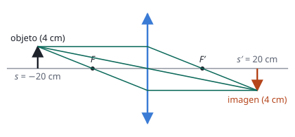

## Enunciado

Se sitúa a la izquierda de una lente convergente un objeto de 4 cm de altura, formándose una imagen real de tamaño 2 cm. La distancia entre la posición del objeto y la posición de la imagen es de 45 cm.

1. (1,5 puntos) Determine la posición del objeto, de la imagen y la distancia focal de la lente.
2. (1 punto) Halle la posición en la que hay que colocar el objeto para que el tamaño de la imagen real que se forme sea de 4 cm. Realice en este caso el correspondiente diagrama de rayos.

## Datos

Con el criterio de signos DIN:

- Altura del objeto: $y = +4\ \mathrm{cm}$
- La imagen es real, y una lente convergente da las imágenes reales **invertidas**: $y' = -2\ \mathrm{cm}$
- El objeto está a la izquierda ($s < 0$) y la imagen real a la derecha ($s' > 0$); la distancia entre ambos es $s' - s = 45\ \mathrm{cm}$

## Planteamiento

El enunciado da los tamaños «2 cm» y «4 cm» sin signo, y la primera decisión es ponérselo. Una imagen real formada por una sola lente siempre está invertida, de modo que el aumento es negativo.

Con el aumento y la distancia total hay dos ecuaciones para las dos posiciones. Después, la ecuación de la lente da la focal.

## Resolución

### a) Posiciones del objeto y de la imagen, y distancia focal

**Aumento lateral.**

$$M = \frac{y'}{y} = \frac{-2}{4} = -\frac12
\qquad\text{y}\qquad
M = \frac{s'}{s}
\quad\Longrightarrow\quad
s = -2\,s'$$

**Distancia entre objeto e imagen.**

$$s' - s = 45
\quad\Longrightarrow\quad
s' + 2\,s' = 45
\quad\Longrightarrow\quad
s' = 15{,}0\ \mathrm{cm}$$

$$s = -2\cdot 15 = -30{,}0\ \mathrm{cm}$$

El objeto está 30 cm a la izquierda de la lente y la imagen, 15 cm a la derecha.

**Distancia focal.**

$$\frac{1}{f'} = \frac{1}{s'} - \frac{1}{s} = \frac{1}{15} + \frac{1}{30} = \frac{3}{30}
\quad\Longrightarrow\quad
f' = 10{,}0\ \mathrm{cm}$$

Positiva, como corresponde a una lente convergente.

### b) Posición del objeto para una imagen real de 4 cm

Ahora la imagen tiene el mismo tamaño que el objeto y sigue siendo real, luego invertida: $y' = -4\ \mathrm{cm}$ y $M = -1$.

$$M = \frac{s'}{s} = -1
\quad\Longrightarrow\quad
s' = -s$$

En la ecuación de la lente:

$$\frac{1}{-s} - \frac{1}{s} = \frac{1}{f'}
\quad\Longrightarrow\quad
-\frac{2}{s} = \frac{1}{10}
\quad\Longrightarrow\quad
s = -20{,}0\ \mathrm{cm}$$

El objeto debe colocarse 20 cm a la izquierda de la lente, es decir, a $2f'$. La imagen se forma a 20 cm a la derecha. Es un resultado general: un objeto situado al doble de la distancia focal da una imagen real, invertida y del mismo tamaño.

**Diagrama de rayos.** Desde el extremo del objeto:

- el rayo paralelo al eje se refracta pasando por el foco imagen $F'$;
- el rayo que pasa por el centro de la lente no se desvía;
- el rayo que pasa por el foco objeto $F$ sale paralelo al eje.

## Errores típicos

- Tomar $y' = +2\ \mathrm{cm}$. Con aumento positivo la imagen sería virtual, y el enunciado dice que es real.
- Escribir la distancia entre objeto e imagen como $s' + s = 45$. Como $s$ es negativa, la distancia es $s' - s$.
- En el apartado b, usar $M = +1$: daría $s' = s$, que no tiene solución.
- Hacer el diagrama de rayos del apartado a en lugar del b.
