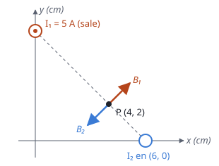

## Enunciado

Un hilo rectilíneo infinito paralelo al eje $z$ pasa por el punto $(0, 6, 0)\ \mathrm{cm}$ y transporta una corriente $I = 5\ \mathrm{A}$ en el sentido positivo del eje $z$.

1. (1,25 puntos) Calcule el campo magnético creado por el hilo en el punto $(4, 2, 0)\ \mathrm{cm}$.
2. (1,25 puntos) Determine la intensidad de corriente que debe transportar un segundo hilo rectilíneo infinito que se sitúe paralelo al eje $z$ y que pase por el punto $(6, 0, 0)\ \mathrm{cm}$ para que el campo magnético total en el punto $(4, 2, 0)\ \mathrm{cm}$ sea cero.

**Dato:** Permeabilidad magnética del vacío, $\mu_0 = 4\pi\cdot 10^{-7}\ \mathrm{T\,m\,A^{-1}}$.

## Datos

- Hilo 1 en $(0, 6)\ \mathrm{cm}$, con $I_1 = 5\ \mathrm{A}$ en $+z$ (sale del papel)
- Punto P en $(4, 2)\ \mathrm{cm}$
- Hilo 2 en $(6, 0)\ \mathrm{cm}$
- Distancias a P:

$$d_1 = \sqrt{4^2 + 4^2} = 4\sqrt 2\ \mathrm{cm} = 5{,}66\cdot 10^{-2}\ \mathrm{m}
\qquad
d_2 = \sqrt{2^2 + 2^2} = 2\sqrt 2\ \mathrm{cm}$$

## Planteamiento

Los hilos son perpendiculares al plano $xy$, así que se dibujan como puntos y todo el problema ocurre en ese plano. El campo de un hilo recto forma circunferencias alrededor de él: en cada punto es **perpendicular** a la línea que une el hilo con el punto, y su sentido lo da la regla de la mano derecha (antihorario si la corriente sale del papel).

Los tres puntos están sobre la misma recta, $y = 6 - x$, con P entre los dos hilos. Los dos campos en P son perpendiculares a esa recta, y por eso pueden anularse.

## Resolución

### a) Campo del primer hilo en P

**Módulo.**

$$B_1 = \frac{\mu_0\,I_1}{2\pi\,d_1} = \frac{4\pi\cdot 10^{-7}\cdot 5}{2\pi\cdot 5{,}66\cdot 10^{-2}} = 1{,}77\cdot 10^{-5}\ \mathrm{T}$$

**Dirección y sentido.** Para ir del hilo a P hay que moverse 4 cm a la derecha y 4 cm hacia abajo. El campo es perpendicular a esa dirección, y con la corriente saliendo del papel gira en sentido antihorario: en P apunta hacia la derecha y hacia arriba, a 45°.

Con vectores se obtiene lo mismo. El vector unitario del hilo a P es $\vec u_r = (\vec i - \vec j)/\sqrt 2$, y el sentido del campo es $\vec k\times\vec u_r = (\vec i + \vec j)/\sqrt 2$.

$$\begin{aligned}
\vec B_1 &= 1{,}77\cdot 10^{-5}\,(\cos 45^\circ\,\vec i + \operatorname{sen}45^\circ\,\vec j) \\[4pt]
         &= (1{,}25\cdot 10^{-5}\,\vec i + 1{,}25\cdot 10^{-5}\,\vec j)\ \ \mathrm{T}
\end{aligned}$$

### b) Corriente del segundo hilo

**Sentido.** El campo del segundo hilo en P tiene que apuntar al revés que $\vec B_1$: hacia la izquierda y hacia abajo. P está arriba y a la izquierda del hilo 2; una corriente saliente da allí un campo que gira en sentido antihorario, es decir, hacia la izquierda y hacia abajo. Justo lo que hace falta: la corriente va también en el sentido **positivo del eje $z$**.

Es el resultado conocido: entre dos hilos con corrientes del mismo sentido los campos se restan.

**Valor.** Igualamos los módulos:

$$\frac{\mu_0\,I_1}{2\pi\,d_1} = \frac{\mu_0\,I_2}{2\pi\,d_2}
\quad\Longrightarrow\quad
I_2 = I_1\,\frac{d_2}{d_1} = 5\cdot\frac{2\sqrt 2}{4\sqrt 2} = 2{,}50\ \mathrm{A}$$

El segundo hilo está a la mitad de distancia y necesita la mitad de corriente.

## Errores típicos

- Dibujar el campo apuntando hacia el hilo o alejándose de él, como si fuera un campo eléctrico. El campo magnético de un hilo es tangente a circunferencias centradas en él.
- Dejar las distancias en centímetros.
- En el apartado b, dar la corriente en sentido contrario: entre los hilos, corrientes opuestas dan campos que se suman.
- Dar solo el valor de $I_2$ sin indicar el sentido.
