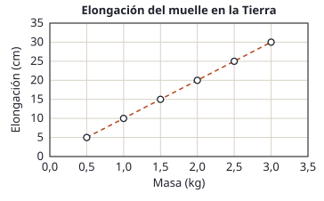
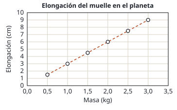

## Enunciado

Un equipo de astronautas se dirige a un planeta de masa desconocida. Con el objetivo de poder determinar su masa una vez que estén en su superficie, previamente calibran un muelle en la Tierra suspendiendo del mismo distintas masas. La gráfica que obtienen se puede ver en la figura 1.

Cuando llegan al planeta desconocido utilizan las mismas masas y miden la elongación del muelle, para así determinar la gravedad en la superficie. En este caso, obtienen la gráfica de la figura 2.

1. (0,5 puntos) Halle la constante del muelle utilizando la gráfica de la figura 1, aproximando el valor de la aceleración de la gravedad en la superficie de la Tierra como $g = 10\ \mathrm{m\,s^{-2}}$.
2. (1 punto) Determine la aceleración de la gravedad en la superficie del planeta utilizando la gráfica de la figura 2.
3. (1 punto) Sabiendo que el radio del planeta es de $3{,}5\cdot 10^{3}\ \mathrm{km}$, calcule la masa del planeta.

**Dato:** Constante de Gravitación Universal, $G = 6{,}67\cdot 10^{-11}\ \mathrm{N\,m^2\,kg^{-2}}$.

## Datos

- Figura 1 (Tierra): con $m = 2\ \mathrm{kg}$ el muelle se alarga $20\ \mathrm{cm} = 0{,}20\ \mathrm{m}$
- Figura 2 (planeta): con $m = 2\ \mathrm{kg}$ el muelle se alarga $6\ \mathrm{cm} = 0{,}06\ \mathrm{m}$
- $g_T = 10\ \mathrm{m\,s^{-2}}$
- Radio del planeta: $R = 3{,}5\cdot 10^{3}\ \mathrm{km} = 3{,}5\cdot 10^{6}\ \mathrm{m}$

## Planteamiento

Una masa colgada de un muelle queda en equilibrio cuando la fuerza elástica iguala al peso: $k\,x = m\,g$. La elongación es proporcional a la masa, y por eso las dos gráficas son rectas que pasan por el origen. La pendiente de cada recta es $g/k$.

El muelle es el mismo en los dos sitios. En la Tierra se conoce $g$ y se obtiene $k$; en el planeta se conoce ya $k$ y se obtiene $g$. Con la gravedad en la superficie y el radio, la ley de gravitación da la masa.

## Resolución

### a) Constante del muelle

En equilibrio, $k\,x = m\,g_T$. Con el punto de 2 kg y 0,20 m de la figura 1:

$$k = \frac{m\,g_T}{x} = \frac{2\cdot 10}{0{,}20} = 100\ \mathrm{N\,m^{-1}}$$

Cualquier otro punto da lo mismo, porque todos están sobre la recta: con 1 kg y 0,10 m, $1\cdot 10/0{,}10 = 100\ \mathrm{N\,m^{-1}}$.

### b) Gravedad en la superficie del planeta

El mismo equilibrio, ahora con la gravedad del planeta como incógnita. Con el punto de 2 kg y 0,06 m de la figura 2:

$$k\,x = m\,g_P
\quad\Longrightarrow\quad
g_P = \frac{k\,x}{m} = \frac{100\cdot 0{,}06}{2} = 3{,}00\ \mathrm{m\,s^{-2}}$$

Se puede ver sin calcular $k$: con la misma masa el muelle se estira 6 cm en lugar de 20, así que la gravedad es $6/20$ de la terrestre.

### c) Masa del planeta

La gravedad en la superficie de un planeta de masa $M_P$ y radio $R$ es:

$$g_P = G\,\frac{M_P}{R^2}
\quad\Longrightarrow\quad
M_P = \frac{g_P\,R^2}{G}$$

$$M_P = \frac{3{,}00\cdot (3{,}5\cdot 10^{6})^2}{6{,}67\cdot 10^{-11}} = 5{,}51\cdot 10^{23}\ \mathrm{kg}$$

Aproximadamente la décima parte de la masa de la Tierra: un planeta parecido a Marte.

## Errores típicos

- Dejar las elongaciones en centímetros: saldría $k = 1\ \mathrm{N\,m^{-1}}$.
- Leer un punto que no está sobre un cruce de la cuadrícula. Los de 1, 2 y 3 kg se leen sin error.
- Usar $g = 9{,}8$ cuando el enunciado dice 10.
- Dejar el radio del planeta en kilómetros, o no elevarlo al cuadrado.
