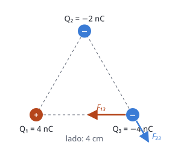

## Enunciado

Sea una distribución de tres cargas puntuales fijas, situadas en los vértices de un triángulo equilátero, en el plano $xy$: $Q_1 = 4\ \mathrm{nC}$ situada en el punto $P_1(0, 0)\ \mathrm{cm}$, $Q_2 = -2\ \mathrm{nC}$ situada en el punto $P_2(2, 2\sqrt 3)\ \mathrm{cm}$ y $Q_3 = -4\ \mathrm{nC}$ situada en el punto $P_3(4, 0)\ \mathrm{cm}$.

1. (1 punto) Calcule la fuerza total que $Q_1$ y $Q_2$ ejercen sobre la carga $Q_3$.
2. (1,5 puntos) Obtenga la energía electrostática de la distribución de cargas.

**Dato:** Constante de la ley de Coulomb, $K = 9\cdot 10^{9}\ \mathrm{N\,m^2\,C^{-2}}$.

## Datos

- $Q_1 = +4\cdot 10^{-9}\ \mathrm{C}$, $Q_2 = -2\cdot 10^{-9}\ \mathrm{C}$, $Q_3 = -4\cdot 10^{-9}\ \mathrm{C}$
- Lado del triángulo: $d = 4\ \mathrm{cm} = 0{,}04\ \mathrm{m}$ (las tres distancias son iguales)

## Planteamiento

Sobre $Q_3$ actúan dos fuerzas. $Q_1$ tiene signo contrario y la **atrae**: la fuerza va de $Q_3$ hacia $Q_1$, en el sentido $-x$. $Q_2$ tiene el mismo signo y la **repele**: la fuerza se aleja de $Q_2$, hacia abajo y a la derecha, formando 60° con el eje $x$ por ser el triángulo equilátero. Se calcula el módulo de cada una con la ley de Coulomb y se suman las componentes.

La energía electrostática del conjunto es la suma de las energías potenciales de **cada pareja** de cargas. Con tres cargas hay tres parejas.

## Resolución

### a) Fuerza sobre Q₃

**Fuerza de $Q_1$** (atractiva, hacia $-x$):

$$F_{13} = K\,\frac{|Q_1\,Q_3|}{d^2} = \frac{9\cdot 10^{9}\cdot 4\cdot 10^{-9}\cdot 4\cdot 10^{-9}}{0{,}04^2} = 9{,}00\cdot 10^{-5}\ \mathrm{N}$$

$$\vec F_{13} = -9{,}00\cdot 10^{-5}\,\vec i\ \ \mathrm{N}$$

**Fuerza de $Q_2$** (repulsiva, a 60° por debajo del eje $x$):

$$F_{23} = K\,\frac{|Q_2\,Q_3|}{d^2} = \frac{9\cdot 10^{9}\cdot 2\cdot 10^{-9}\cdot 4\cdot 10^{-9}}{0{,}04^2} = 4{,}50\cdot 10^{-5}\ \mathrm{N}$$

$$\begin{aligned}
\vec F_{23} &= 4{,}50\cdot 10^{-5}\,(\cos 60^\circ\,\vec i - \operatorname{sen}60^\circ\,\vec j) \\[4pt]
            &= (2{,}25\cdot 10^{-5}\,\vec i - 3{,}90\cdot 10^{-5}\,\vec j)\ \ \mathrm{N}
\end{aligned}$$

**Fuerza total.**

$$\begin{aligned}
\vec F &= \vec F_{13} + \vec F_{23} \\[4pt]
       &= (-6{,}75\cdot 10^{-5}\,\vec i - 3{,}90\cdot 10^{-5}\,\vec j)\ \ \mathrm{N}
\end{aligned}$$

Su módulo es $7{,}79\cdot 10^{-5}\ \mathrm{N}$.

### b) Energía electrostática de la distribución

Suma de las tres parejas, con las cargas con su signo:

$$E_p = K\,\frac{Q_1 Q_2}{d} + K\,\frac{Q_1 Q_3}{d} + K\,\frac{Q_2 Q_3}{d} = \frac{K}{d}\,(Q_1 Q_2 + Q_1 Q_3 + Q_2 Q_3)$$

Los productos, en $\mathrm{nC^2}$: $4\cdot(-2) = -8$; $4\cdot(-4) = -16$; $(-2)\cdot(-4) = +8$. Suman $-16\ \mathrm{nC^2} = -16\cdot 10^{-18}\ \mathrm{C^2}$.

$$E_p = \frac{9\cdot 10^{9}}{0{,}04}\cdot (-16\cdot 10^{-18}) = -3{,}60\cdot 10^{-6}\ \mathrm{J}$$

Es negativa: en conjunto dominan las atracciones, y habría que aportar $3{,}6\ \mathrm{\mu J}$ para separar las tres cargas hasta el infinito.

## Errores típicos

- Dibujar la fuerza de $Q_2$ hacia ella. Dos cargas negativas se repelen.
- Meter los signos de las cargas en el módulo y además en el dibujo, con lo que se cuentan dos veces. En la fuerza: módulos con valores absolutos y sentido con el dibujo.
- En la energía, al revés: las cargas van **con su signo**.
- Contar solo dos parejas, o contar cada pareja dos veces.
- Elevar la distancia al cuadrado en la energía.
