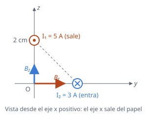

## Enunciado

Un hilo rectilíneo infinito situado paralelo al eje $x$, que pasa por el punto $(0, 0, 2)\ \mathrm{cm}$, transporta una corriente $I_1 = 5\ \mathrm{A}$ en el sentido positivo del eje $x$. Un segundo hilo paralelo al primero, que pasa por el punto $(0, 2, 0)\ \mathrm{cm}$, transporta una corriente $I_2 = 3\ \mathrm{A}$ en el sentido negativo del eje $x$.

1. (1,5 puntos) Obtenga el campo magnético creado por ambos hilos en el origen de coordenadas.
2. (1 punto) Calcule el módulo de la fuerza por unidad de longitud que ejerce el primer hilo sobre el segundo.

**Dato:** Permeabilidad magnética del vacío, $\mu_0 = 4\pi\cdot 10^{-7}\ \mathrm{T\,m\,A^{-1}}$.

## Datos

- Hilo 1: pasa por $z = 2\ \mathrm{cm}$ sobre el eje $z$; $I_1 = 5\ \mathrm{A}$ hacia $+x$
- Hilo 2: pasa por $y = 2\ \mathrm{cm}$ sobre el eje $y$; $I_2 = 3\ \mathrm{A}$ hacia $-x$
- Distancia de cada hilo al origen: $d = 2\ \mathrm{cm} = 0{,}02\ \mathrm{m}$
- Distancia entre los hilos: $\sqrt{2^2 + 2^2} = 2\sqrt 2\ \mathrm{cm} = 2{,}83\cdot 10^{-2}\ \mathrm{m}$

## Planteamiento

La dificultad del problema es geométrica: los hilos van a lo largo del eje $x$ y todo lo interesante ocurre en el plano $yz$. Conviene dibujar ese plano mirando desde el eje $x$ positivo, con el eje $x$ saliendo del papel. Así el hilo 1 es un punto (corriente que sale) y el hilo 2 un aspa (corriente que entra).

El campo de cada hilo es tangente a la circunferencia centrada en él, con sentido antihorario si la corriente sale y horario si entra.

## Resolución

### a) Campo magnético en el origen

**Hilo 1.** Módulo:

$$B_1 = \frac{\mu_0\,I_1}{2\pi\,d} = \frac{4\pi\cdot 10^{-7}\cdot 5}{2\pi\cdot 0{,}02} = 5{,}00\cdot 10^{-5}\ \mathrm{T}$$

El origen está justo debajo del hilo 1. Una corriente saliente da un campo que gira en sentido antihorario, y en el punto más bajo de la circunferencia ese giro va hacia la derecha, es decir, hacia $+y$.

Con vectores: el sentido es $\vec u_I\times\vec u_r$, con $\vec u_I = \vec i$ el sentido de la corriente y $\vec u_r = -\vec k$ el vector del hilo al origen. Como $\vec i\times(-\vec k) = \vec j$:

$$\vec B_1 = 5{,}00\cdot 10^{-5}\,\vec j\ \ \mathrm{T}$$

**Hilo 2.** Módulo:

$$B_2 = \frac{\mu_0\,I_2}{2\pi\,d} = \frac{4\pi\cdot 10^{-7}\cdot 3}{2\pi\cdot 0{,}02} = 3{,}00\cdot 10^{-5}\ \mathrm{T}$$

El origen está a la izquierda del hilo 2. Una corriente entrante da un giro horario, que a la izquierda del hilo va hacia arriba, hacia $+z$. Con vectores: $(-\vec i)\times(-\vec j) = \vec k$.

$$\vec B_2 = 3{,}00\cdot 10^{-5}\,\vec k\ \ \mathrm{T}$$

**Campo total.**

$$\vec B = (5{,}00\cdot 10^{-5}\,\vec j + 3{,}00\cdot 10^{-5}\,\vec k)\ \ \mathrm{T}$$

Su módulo es $5{,}83\cdot 10^{-5}\ \mathrm{T}$.

### b) Fuerza por unidad de longitud entre los hilos

Para dos hilos paralelos separados una distancia $D$:

$$\frac{F}{L} = \frac{\mu_0\,I_1\,I_2}{2\pi\,D} = \frac{4\pi\cdot 10^{-7}\cdot 5\cdot 3}{2\pi\cdot 2{,}83\cdot 10^{-2}} = 1{,}06\cdot 10^{-4}\ \mathrm{N\,m^{-1}}$$

Como las corrientes tienen sentidos opuestos, la fuerza es **repulsiva**.

## Errores típicos

- Usar 2 cm como distancia entre los hilos en el apartado b. Esa es la distancia de cada hilo al origen; entre ellos hay $2\sqrt 2\ \mathrm{cm}$.
- Sumar los módulos de los campos, $5 + 3$. Son perpendiculares entre sí.
- Dibujar el campo apuntando hacia el hilo o en la dirección de la corriente.
- Dejar las distancias en centímetros.
- Decir que los hilos se atraen: corrientes opuestas se repelen.
