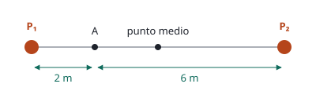

## Enunciado

Sean dos fuentes sonoras puntuales de potencias $P_1$ y $P_2$ separadas 8 m. La suma de sus potencias es de 50 W. Si la intensidad medida en un punto situado en el segmento que une ambas fuentes, a 2 m de distancia de la fuente de potencia $P_1$, es de $7{,}3\cdot 10^{-1}\ \mathrm{W\,m^{-2}}$, determine:

1. (1,5 puntos) Los valores de las potencias de las fuentes $P_1$ y $P_2$.
2. (1 punto) El nivel de intensidad sonora en el punto medio entre ambas fuentes.

**Dato:** Intensidad umbral, $I_0 = 1\cdot 10^{-12}\ \mathrm{W\,m^{-2}}$.

## Datos

- $P_1 + P_2 = 50\ \mathrm{W}$
- Punto A: a $r_1 = 2\ \mathrm{m}$ de la fuente 1 y, por tanto, a $r_2 = 8 - 2 = 6\ \mathrm{m}$ de la fuente 2
- Intensidad en A: $I_A = 0{,}73\ \mathrm{W\,m^{-2}}$
- Punto medio: a 4 m de cada fuente

## Planteamiento

Cada fuente es puntual y reparte su potencia sobre esferas: $I = P/(4\pi r^2)$. En un punto donde llegan los sonidos de dos fuentes independientes, las **intensidades se suman**. Eso da una ecuación con $P_1$ y $P_2$; la otra es que suman 50 W.

Para el nivel sonoro en el punto medio se calcula primero la intensidad total y después se pasa a decibelios. Nunca al revés.

## Resolución

### a) Potencias de las fuentes

Intensidad en el punto A:

$$I_A = \frac{P_1}{4\pi\,r_1^2} + \frac{P_2}{4\pi\,r_2^2} = \frac{P_1}{4\pi\cdot 4} + \frac{P_2}{4\pi\cdot 36}$$

Multiplicamos todo por $4\pi\cdot 36$ para quitar denominadores:

$$9\,P_1 + P_2 = 4\pi\cdot 36\cdot 0{,}73 = 330{,}2$$

Junto con $P_1 + P_2 = 50$, restando las dos ecuaciones:

$$8\,P_1 = 330{,}2 - 50 = 280{,}2
\quad\Longrightarrow\quad
P_1 = 35{,}0\ \mathrm{W}$$

$$P_2 = 50 - 35{,}0 = 15{,}0\ \mathrm{W}$$

### b) Nivel de intensidad sonora en el punto medio

El punto medio está a 4 m de las dos fuentes:

$$I = \frac{P_1}{4\pi\cdot 4^2} + \frac{P_2}{4\pi\cdot 4^2} = \frac{P_1 + P_2}{4\pi\cdot 16} = \frac{50}{64\pi} = 0{,}249\ \mathrm{W\,m^{-2}}$$

$$\beta = 10\log\frac{I}{I_0} = 10\log\frac{0{,}249}{1\cdot 10^{-12}} = 114\ \mathrm{dB}$$

Un detalle: al estar el punto a la misma distancia de las dos fuentes, la intensidad solo depende de la **suma** de las potencias, que era dato. Este apartado se puede resolver aunque el anterior esté mal.

## Errores típicos

- Tomar 8 m, y no 6 m, como distancia del punto A a la segunda fuente.
- Calcular el nivel de cada fuente por separado y sumar los decibelios. Se suman las intensidades.
- Usar $\pi r^2$ en lugar de $4\pi r^2$.
- Olvidar elevar las distancias al cuadrado al plantear el sistema.
