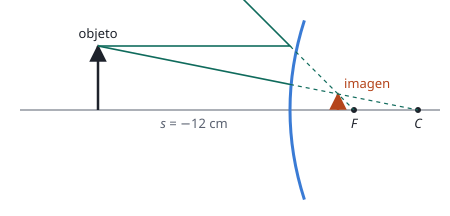

## Enunciado

Se desea fabricar un espejo convexo tal que, al situar un objeto a la izquierda del espejo a 12 cm de distancia, se forme una imagen cuyo tamaño se reduzca a la cuarta parte de su tamaño original.

1. (1,5 puntos) Determine la posición en la que se formará la imagen y el radio de curvatura del espejo.
2. (1 punto) Realice el correspondiente diagrama de rayos.

## Datos

Con el criterio de signos DIN (distancias medidas desde el vértice del espejo, positivas hacia la derecha):

- Objeto a la izquierda: $s = -12\ \mathrm{cm}$
- Un espejo convexo da siempre imágenes **derechas**, así que el aumento es positivo: $M = +\dfrac14$

## Planteamiento

Un espejo convexo siempre forma, de un objeto real, una imagen virtual, derecha y más pequeña. Saber que es derecha fija el signo del aumento. Con el aumento se obtiene la posición de la imagen; con las dos posiciones, la ecuación del espejo da la focal, y el radio es el doble.

Las ecuaciones de los espejos se parecen a las de las lentes, pero cambian dos signos: suma en lugar de resta en la ecuación principal, y un signo menos en el aumento.

## Resolución

### a) Posición de la imagen y radio de curvatura

**Posición de la imagen.** Aumento lateral de un espejo:

$$M = \frac{y'}{y} = -\frac{s'}{s}
\quad\Longrightarrow\quad
s' = -M\,s = -\frac14\cdot(-12) = 3{,}00\ \mathrm{cm}$$

Positiva: la imagen se forma 3 cm a la derecha del vértice, es decir, **detrás** del espejo. Es virtual.

**Distancia focal.**

$$\frac{1}{f} = \frac{1}{s'} + \frac{1}{s} = \frac{1}{3} + \frac{1}{-12} = \frac{4 - 1}{12} = \frac14
\quad\Longrightarrow\quad
f = 4\ \mathrm{cm}$$

**Radio de curvatura.**

$$R = 2f = 8{,}00\ \mathrm{cm}$$

El radio sale positivo, con el centro de curvatura a la derecha del vértice, como corresponde a un espejo convexo.

### b) Diagrama de rayos

Desde el extremo del objeto se trazan dos rayos:

- El rayo **paralelo al eje** se refleja como si viniera del foco $F$, que está detrás del espejo. Se dibuja el rayo reflejado alejándose y su prolongación hacia $F$ con línea de puntos.
- El rayo que **apunta al centro de curvatura** $C$ incide perpendicularmente sobre el espejo y vuelve por el mismo camino. Su prolongación pasa por $C$.

Los rayos reflejados se separan y no se cortan. Sus prolongaciones sí, detrás del espejo: ahí está la imagen, virtual, derecha y de la cuarta parte del tamaño.

## Errores típicos

- Usar las ecuaciones de las lentes: $1/s' - 1/s$ y $M = s'/s$. En los espejos son $1/s' + 1/s = 1/f$ y $M = -s'/s$.
- Tomar el aumento como $-1/4$. Daría una imagen real e invertida, que un espejo convexo no puede formar.
- Poner el foco y el centro delante del espejo, como en uno cóncavo.
- Dar la focal en lugar del radio.
