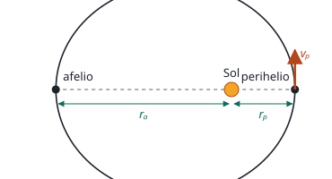

## Enunciado

Eris es un planeta enano del sistema solar descubierto en enero de 2005 por un equipo del observatorio del Monte Palomar dirigido por Michael E. Brown. Es el objeto transneptuniano más masivo, el segundo más grande después de Plutón, y el cuerpo más grande del sistema solar que no ha sido visitado por una sonda espacial. Tiene un diámetro de 2330 km, ligeramente inferior al de Plutón, y su densidad es de $2{,}5\ \mathrm{g\,cm^{-3}}$. La órbita de Eris es muy excéntrica; actualmente el planeta se encuentra a su máxima distancia del Sol (afelio), a $1{,}45\cdot 10^{13}\ \mathrm{m}$, llegando a situarse a $5{,}24\cdot 10^{12}\ \mathrm{m}$ del Sol durante su perihelio.

1. (1 punto) Calcule la masa del planeta y el valor de la aceleración de la gravedad en su superficie.
2. (1,5 puntos) Sabiendo que la energía mecánica de un objeto de masa $m_1$ que orbita alrededor de un objeto de masa $m_2$ con una órbita elíptica de semieje mayor $a$ es $E_\text{mec} = -\dfrac{G\,m_1\,m_2}{2a}$, donde $G$ es la constante de la gravitación universal, halle la energía mecánica de Eris y calcule la velocidad orbital que tendrá en el perihelio.

**Datos:** Constante de gravitación universal, $G = 6{,}67\cdot 10^{-11}\ \mathrm{N\,m^2\,kg^{-2}}$; Masa del Sol, $M_\text{Sol} = 1{,}99\cdot 10^{30}\ \mathrm{kg}$.

## Datos

- Radio de Eris: la mitad del diámetro, $R = 1165\ \mathrm{km} = 1{,}165\cdot 10^{6}\ \mathrm{m}$
- Densidad: $\rho = 2{,}5\ \mathrm{g\,cm^{-3}} = 2{,}5\cdot 10^{3}\ \mathrm{kg\,m^{-3}}$
- Afelio: $r_a = 1{,}45\cdot 10^{13}\ \mathrm{m}$; perihelio: $r_p = 5{,}24\cdot 10^{12}\ \mathrm{m}$

## Planteamiento

El primer apartado trata a Eris como un astro: su masa sale de la densidad y el volumen de una esfera, y con la masa y el radio se obtiene la gravedad en la superficie.

El segundo lo trata como un cuerpo que orbita. El eje mayor de la elipse va del afelio al perihelio, así que $2a = r_a + r_p$. Con $a$, el enunciado ya da la energía mecánica. Y como esa energía es la misma en toda la órbita, en el perihelio debe ser igual a la suma de la energía cinética y la potencial: de ahí se despeja la velocidad.

## Resolución

### a) Masa de Eris y gravedad en su superficie

**Masa.** Volumen de una esfera por la densidad:

$$V = \frac43\,\pi\,R^3 = \frac43\,\pi\,(1{,}165\cdot 10^{6})^3 = 6{,}62\cdot 10^{18}\ \mathrm{m^3}$$

$$M_E = \rho\,V = 2{,}5\cdot 10^{3}\cdot 6{,}62\cdot 10^{18} = 1{,}66\cdot 10^{22}\ \mathrm{kg}$$

**Gravedad en la superficie.**

$$g = G\,\frac{M_E}{R^2} = \frac{6{,}67\cdot 10^{-11}\cdot 1{,}66\cdot 10^{22}}{(1{,}165\cdot 10^{6})^2} = 0{,}814\ \mathrm{m\,s^{-2}}$$

Doce veces menor que en la Tierra.

### b) Energía mecánica y velocidad en el perihelio

**Semieje mayor.**

$$a = \frac{r_a + r_p}{2} = \frac{1{,}45\cdot 10^{13} + 5{,}24\cdot 10^{12}}{2} = 9{,}87\cdot 10^{12}\ \mathrm{m}$$

**Energía mecánica.** Con la expresión del enunciado:

$$\begin{aligned}
E_m &= -\frac{G\,M_\text{Sol}\,M_E}{2a} \\[4pt]
    &= -\frac{6{,}67\cdot 10^{-11}\cdot 1{,}99\cdot 10^{30}\cdot 1{,}66\cdot 10^{22}}{2\cdot 9{,}87\cdot 10^{12}} \\[4pt]
    &= -1{,}11\cdot 10^{29}\ \mathrm{J}
\end{aligned}$$

**Velocidad en el perihelio.** La energía mecánica en ese punto es cinética más potencial:

$$-\frac{G\,M_\text{Sol}\,M_E}{2a} = \frac12\,M_E\,v_p^2 - \frac{G\,M_\text{Sol}\,M_E}{r_p}$$

La masa de Eris se simplifica en los tres términos. Despejando:

$$v_p = \sqrt{2\,G\,M_\text{Sol}\left(\frac{1}{r_p} - \frac{1}{2a}\right)}$$

$$\begin{aligned}
v_p &= \sqrt{2\cdot 6{,}67\cdot 10^{-11}\cdot 1{,}99\cdot 10^{30}\left(\frac{1}{5{,}24\cdot 10^{12}} - \frac{1}{1{,}974\cdot 10^{13}}\right)} \\[4pt]
    &= 6{,}10\cdot 10^{3}\ \mathrm{m\,s^{-1}}
\end{aligned}$$

La velocidad no depende de la masa de Eris, igual que ocurre en las órbitas circulares.

## Errores típicos

- Usar el diámetro como radio. Al ir elevado al cubo, la masa saldría ocho veces mayor.
- Pasar mal la densidad: $1\ \mathrm{g\,cm^{-3}}$ son $1000\ \mathrm{kg\,m^{-3}}$.
- Tomar como semieje mayor la distancia al afelio.
- Calcular la velocidad en el perihelio con $\sqrt{GM/r_p}$. Esa fórmula es de órbitas circulares.
- Confundir las dos masas: en el apartado a el campo lo crea Eris; en el b, el Sol.
