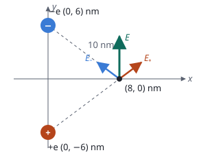

## Enunciado

Un electrón de carga $-e$ y un positrón de carga $+e$ se encuentran inicialmente fijos en el plano $xy$ en las posiciones $(0, 6)\ \mathrm{nm}$ y $(0, -6)\ \mathrm{nm}$, respectivamente.

1. (1,25 puntos) Obtenga el campo eléctrico en el punto $(8, 0)\ \mathrm{nm}$ debido a ambas partículas.
2. (1,25 puntos) Si al positrón se le imprime una velocidad de $-1{,}5\cdot 10^{5}\ \mathrm{m\,s^{-1}}\ \vec j$, permaneciendo fijo el electrón, determine la máxima distancia de alejamiento entre ambas partículas.

**Datos:** Constante de la ley de Coulomb, $K = 9\cdot 10^{9}\ \mathrm{N\,m^2\,C^{-2}}$; Valor absoluto de la carga del electrón y del positrón, $e = 1{,}6\cdot 10^{-19}\ \mathrm{C}$; Masa del electrón y del positrón, $m_e = 9{,}1\cdot 10^{-31}\ \mathrm{kg}$.

## Datos

- Electrón ($-e$) en $(0, 6)\ \mathrm{nm}$; positrón ($+e$) en $(0, -6)\ \mathrm{nm}$
- Distancia de cada uno al punto $(8, 0)\ \mathrm{nm}$: $d = \sqrt{6^2 + 8^2} = 10\ \mathrm{nm} = 1{,}0\cdot 10^{-8}\ \mathrm{m}$
- Separación inicial entre las partículas: $d_0 = 12\ \mathrm{nm} = 1{,}2\cdot 10^{-8}\ \mathrm{m}$
- Velocidad inicial del positrón: $v_0 = 1{,}5\cdot 10^{5}\ \mathrm{m\,s^{-1}}$, hacia $-y$

## Planteamiento

En el primer apartado el punto está a la misma distancia de dos cargas de igual valor y signo contrario: los dos campos tienen el mismo módulo. El del positrón se aleja de él (hacia arriba y a la derecha) y el del electrón va hacia él (hacia arriba y a la izquierda). Las componentes horizontales se cancelan y las verticales se suman.

En el segundo, el positrón sale disparado hacia abajo, **alejándose** del electrón, que lo atrae y lo va frenando. La distancia máxima se alcanza cuando se detiene. Como la fuerza cambia con la distancia, no sirve la cinemática: se usa la conservación de la energía.

## Resolución

### a) Campo eléctrico en (8, 0) nm

Módulo del campo de cada carga:

$$E_- = E_+ = K\,\frac{e}{d^2} = \frac{9\cdot 10^{9}\cdot 1{,}6\cdot 10^{-19}}{(1{,}0\cdot 10^{-8})^2} = 1{,}44\cdot 10^{7}\ \mathrm{N\,C^{-1}}$$

Cada campo forma con el eje $y$ un ángulo cuyo coseno es $6/10$ y cuyo seno es $8/10$.

- Componentes $x$: la del positrón es $+E_+\cdot 0{,}8$ y la del electrón $-E_-\cdot 0{,}8$. Suman cero.
- Componentes $y$: las dos valen $+1{,}44\cdot 10^{7}\cdot 0{,}6$.

$$\vec E = 2\cdot 1{,}44\cdot 10^{7}\cdot 0{,}6\ \vec j = 1{,}73\cdot 10^{7}\ \vec j\ \ \mathrm{N\,C^{-1}}$$

### b) Distancia máxima de alejamiento

Tomamos como estado inicial el instante en que se lanza el positrón y como estado final el de máximo alejamiento, donde su velocidad es cero.

**Energía cinética inicial.**

$$E_c = \frac12\,m_e\,v_0^2 = \frac12\cdot 9{,}1\cdot 10^{-31}\cdot (1{,}5\cdot 10^{5})^2 = 1{,}02\cdot 10^{-20}\ \mathrm{J}$$

**Energía potencial inicial.** Dos cargas de signo contrario a una distancia $d_0$:

$$E_p = K\,\frac{(+e)(-e)}{d_0} = -\frac{9\cdot 10^{9}\cdot (1{,}6\cdot 10^{-19})^2}{1{,}2\cdot 10^{-8}} = -1{,}92\cdot 10^{-20}\ \mathrm{J}$$

**Conservación de la energía.** En el punto de máximo alejamiento solo hay energía potencial:

$$E_c + E_p = -K\,\frac{e^2}{d_\text{máx}}$$

$$1{,}02\cdot 10^{-20} - 1{,}92\cdot 10^{-20} = -8{,}96\cdot 10^{-21}\ \mathrm{J}$$

$$d_\text{máx} = \frac{K\,e^2}{8{,}96\cdot 10^{-21}} = \frac{2{,}304\cdot 10^{-28}}{8{,}96\cdot 10^{-21}} = 2{,}57\cdot 10^{-8}\ \mathrm{m}$$

El positrón llega a separarse 25,7 nm del electrón, algo más del doble de la distancia inicial, y después vuelve hacia él.

Que la energía total sea **negativa** es lo que garantiza que el positrón no escapa. Si la energía cinética inicial hubiera superado $1{,}92\cdot 10^{-20}\ \mathrm{J}$, no habría distancia máxima.

## Errores típicos

- Dibujar el campo del electrón alejándose de él.
- Sumar los módulos, $2\cdot 1{,}44\cdot 10^{7}$, sin proyectar sobre el eje $y$.
- Perder el signo negativo de la energía potencial: con $E_p$ positiva el resultado no tiene sentido.
- Intentar resolver el apartado b con las ecuaciones del movimiento uniformemente acelerado. La fuerza no es constante.
- Dejar las distancias en nanómetros.
