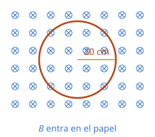

## Enunciado

Una espira conductora circular de radio 20 cm se encuentra en el seno de un campo magnético homogéneo perpendicular al plano de la espira (ver figura). Si la espira tiene una resistencia de $40\ \Omega$, calcule la máxima intensidad de corriente que circulará por la espira en los siguientes casos:

1. (1,25 puntos) El módulo del campo magnético es constante de valor $B = 150\ \mathrm{mT}$, y la espira gira en torno a uno de sus diámetros con una velocidad angular de $50\ \mathrm{rad\,s^{-1}}$.
2. (1,25 puntos) La espira se encuentra fija, y el módulo del campo magnético varía con el tiempo conforme a $B = B_0\operatorname{sen}(\omega t)$, con $B_0 = 200\ \mathrm{mT}$ y $\omega = 75\ \mathrm{rad\,s^{-1}}$.

## Datos

- Radio: $r = 20\ \mathrm{cm} = 0{,}20\ \mathrm{m}$; superficie de la espira:

$$S = \pi\,r^2 = \pi\cdot 0{,}20^2 = 0{,}126\ \mathrm{m^2}$$

- Resistencia: $R = 40\ \Omega$
- Caso a: $B = 0{,}150\ \mathrm{T}$, $\omega = 50\ \mathrm{rad\,s^{-1}}$
- Caso b: $B_0 = 0{,}200\ \mathrm{T}$, $\omega = 75\ \mathrm{rad\,s^{-1}}$

## Planteamiento

El flujo magnético a través de la espira es $\Phi = B\,S\cos\theta$, y puede cambiar porque cambie cualquiera de los tres factores. Los dos apartados son dos maneras distintas de conseguirlo:

- en el **a** cambia el **ángulo**, porque la espira gira;
- en el **b** cambia el **campo**, con la espira quieta.

En los dos casos el camino es el mismo: escribir el flujo en función del tiempo, derivar para obtener la fem (ley de Faraday), quedarse con su valor máximo y dividir entre la resistencia.

## Resolución

### a) Espira que gira en un campo constante

Inicialmente el campo es perpendicular a la espira, es decir, paralelo a su normal ($\theta = 0$). Al girar con velocidad angular $\omega$, el ángulo crece como $\theta = \omega t$:

$$\Phi(t) = B\,S\cos(\omega t)$$

$$\varepsilon(t) = -\frac{\mathrm{d}\Phi}{\mathrm{d}t} = B\,S\,\omega\operatorname{sen}(\omega t)$$

El seno vale como mucho 1, así que el valor máximo de la fem es:

$$\varepsilon_\text{máx} = B\,S\,\omega = 0{,}150\cdot 0{,}126\cdot 50 = 0{,}942\ \mathrm{V}$$

$$I_\text{máx} = \frac{\varepsilon_\text{máx}}{R} = \frac{0{,}942}{40} = 2{,}36\cdot 10^{-2}\ \mathrm{A}$$

Son 23,6 mA. La corriente es máxima cuando la espira está de canto respecto al campo: en ese instante el flujo es cero, pero es cuando más rápido cambia.

### b) Espira fija en un campo variable

Ahora el ángulo no cambia ($\theta = 0$) y lo que depende del tiempo es el campo:

$$\Phi(t) = B_0\,S\operatorname{sen}(\omega t)$$

$$\varepsilon(t) = -\frac{\mathrm{d}\Phi}{\mathrm{d}t} = -B_0\,S\,\omega\cos(\omega t)$$

$$\varepsilon_\text{máx} = B_0\,S\,\omega = 0{,}200\cdot 0{,}126\cdot 75 = 1{,}88\ \mathrm{V}$$

$$I_\text{máx} = \frac{1{,}88}{40} = 4{,}71\cdot 10^{-2}\ \mathrm{A}$$

Son 47,1 mA. Es justo el doble que en el caso anterior, porque el producto $B\,\omega$ es el doble: $0{,}2\cdot 75 = 15$ frente a $0{,}15\cdot 50 = 7{,}5$.

## Errores típicos

- Usar como superficie $2\pi r$ (la longitud de la circunferencia) o dejar el radio en centímetros.
- Calcular la fem como $B\,S/t$ sin derivar. La fem máxima lleva el factor $\omega$ que aparece al derivar el seno o el coseno.
- Pensar que la corriente es máxima cuando el flujo es máximo. Es al revés: en ese instante la fem es nula.
- Dejar el campo en militeslas.
