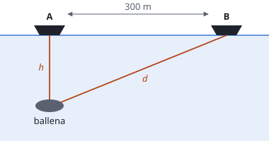

## Enunciado

Una ballena sumergida en el mar a una cierta profundidad emite un potente sonido grave de 60 Hz y 25 m de longitud de onda. Un barco A, situado sobre su vertical, detecta dicho sonido con su sónar 80 ms después de ser emitido, y poco tiempo después es detectado por otro barco B situado a 300 m del barco A.

1. (1 punto) Halle la profundidad a la que se encuentra la ballena.
2. (1,5 puntos) Si el barco A recibe el sonido con una intensidad de $3\ \mathrm{\mu W\,m^{-2}}$, calcule la potencia del sonido emitido por la ballena y el nivel de intensidad sonora que detectará el barco B.

**Dato:** Intensidad umbral, $I_0 = 1\cdot 10^{-12}\ \mathrm{W\,m^{-2}}$.

## Datos

- Frecuencia: $f = 60\ \mathrm{Hz}$; longitud de onda: $\lambda = 25\ \mathrm{m}$
- Tiempo hasta el barco A: $t = 80\ \mathrm{ms} = 0{,}080\ \mathrm{s}$
- Distancia entre barcos: $D = 300\ \mathrm{m}$
- Intensidad en A: $I_A = 3\ \mathrm{\mu W\,m^{-2}} = 3\cdot 10^{-6}\ \mathrm{W\,m^{-2}}$

## Planteamiento

El enunciado no da la velocidad del sonido en el agua, pero da la frecuencia y la longitud de onda, que es lo mismo: $v = \lambda f$. Con la velocidad y el tiempo se obtiene la profundidad.

La ballena es un foco puntual que emite en todas direcciones: su potencia se reparte sobre esferas, y la intensidad cae con el cuadrado de la distancia. El barco B está más lejos que el A; su distancia a la ballena sale del triángulo rectángulo de la figura.

## Resolución

### a) Profundidad de la ballena

Velocidad del sonido en el agua:

$$v = \lambda\,f = 25\cdot 60 = 1500\ \mathrm{m\,s^{-1}}$$

El sonido recorre la distancia $h$ de la ballena al barco A en 80 ms:

$$h = v\,t = 1500\cdot 0{,}080 = 120\ \mathrm{m}$$

### b) Potencia emitida y nivel de intensidad en B

**Potencia.** A la distancia $h$ la potencia está repartida sobre una esfera de radio $h$:

$$I_A = \frac{P}{4\pi h^2}
\quad\Longrightarrow\quad
P = 4\pi h^2\,I_A = 4\pi\cdot 120^2\cdot 3\cdot 10^{-6} = 0{,}543\ \mathrm{W}$$

**Distancia de la ballena al barco B.**

$$d = \sqrt{D^2 + h^2} = \sqrt{300^2 + 120^2} = 323\ \mathrm{m}$$

**Intensidad en B.** Se puede calcular con la potencia o, más corto, comparando con A, porque la intensidad es inversamente proporcional al cuadrado de la distancia:

$$I_B = I_A\,\frac{h^2}{d^2} = 3\cdot 10^{-6}\cdot\frac{120^2}{300^2 + 120^2} = 4{,}14\cdot 10^{-7}\ \mathrm{W\,m^{-2}}$$

**Nivel de intensidad sonora.**

$$\beta_B = 10\log\frac{I_B}{I_0} = 10\log\frac{4{,}14\cdot 10^{-7}}{1\cdot 10^{-12}} = 56{,}2\ \mathrm{dB}$$

En el barco A el nivel es $10\log(3\cdot 10^{6}) = 64{,}8\ \mathrm{dB}$: al alejarse a algo menos del triple de distancia, el nivel baja unos 8,6 dB.

## Errores típicos

- Dividir la distancia entre dos, como en un eco. Aquí el sonido solo hace el camino de ida.
- Tomar 300 m como distancia de la ballena al barco B. Esa es la distancia entre barcos.
- Usar la superficie de un círculo, $\pi r^2$, en lugar de la de una esfera, $4\pi r^2$.
- Dejar la intensidad en microvatios.
- Usar logaritmo neperiano en lugar de decimal.
