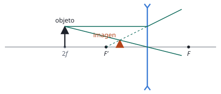

## Enunciado

Considere la imagen formada por una lente delgada de distancia focal $f'$ de un objeto situado a una distancia $s$ a la izquierda de la lente.

1. (1 punto) Demuestre que el aumento lateral $M$ tiene la siguiente expresión en función de la distancia focal $f'$ y la posición del objeto $s$: $M = \dfrac{f'}{f' + s}$
2. (0,5 puntos) Considerando la expresión obtenida en el apartado anterior, razone si una lente divergente puede formar una imagen invertida.
3. (1 punto) Dibuje el trazado de rayos a través del sistema óptico de la imagen formada por una lente divergente si el objeto se sitúa a una distancia dos veces su distancia focal.

## Datos

No hay datos numéricos. Lo que sí hay que tener claro son los signos, con el criterio DIN:

- objeto a la izquierda de la lente: $s < 0$;
- lente divergente: $f' < 0$; lente convergente: $f' > 0$.

## Planteamiento

Es un problema de álgebra con las dos ecuaciones de las lentes delgadas. El enunciado quiere el aumento en función de $s$ y de $f'$, así que hay que **eliminar $s'$**: se despeja de la ecuación de la lente y se sustituye en la del aumento.

El segundo apartado es un razonamiento con signos sobre la expresión obtenida, y el tercero, su comprobación con un dibujo.

## Resolución

### a) Demostración

De la ecuación de la lente despejamos la posición de la imagen:

$$\frac{1}{s'} - \frac{1}{s} = \frac{1}{f'}
\quad\Longrightarrow\quad
\frac{1}{s'} = \frac{1}{f'} + \frac{1}{s} = \frac{s + f'}{f'\,s}$$

$$s' = \frac{f'\,s}{f' + s}$$

Sustituimos en el aumento lateral:

$$M = \frac{s'}{s} = \frac{1}{s}\cdot\frac{f'\,s}{f' + s}
\quad\Longrightarrow\quad
M = \frac{f'}{f' + s}$$

### b) ¿Puede una lente divergente dar una imagen invertida?

Una imagen invertida tiene aumento negativo. Miramos el signo de la expresión para una lente divergente con un objeto real:

- el numerador, $f'$, es **negativo**;
- el denominador, $f' + s$, es la suma de dos números negativos: también **negativo**.

El cociente de dos números negativos es positivo, sea cual sea la posición del objeto. Por tanto $M > 0$ siempre: una lente divergente **no puede** formar una imagen invertida de un objeto real. La imagen es siempre derecha.

Se puede decir algo más: el denominador es mayor en valor absoluto que el numerador, así que $0 < M < 1$ y la imagen es además siempre menor que el objeto.

En cambio, en una lente convergente ($f' > 0$) el denominador cambia de signo cuando el objeto cruza el foco, y por eso puede dar imágenes derechas o invertidas.

### c) Trazado de rayos con el objeto a dos veces la distancia focal

Llamamos $f$ al valor absoluto de la focal: $f' = -f$ y $s = -2f$. La expresión del apartado a predice:

$$M = \frac{-f}{-f - 2f} = \frac13
\qquad\qquad
s' = M\,s = -\frac23\,f$$

La imagen debe salir derecha, tres veces menor que el objeto y a dos tercios de la distancia focal, en el mismo lado que el objeto.

Para el trazado se usan dos rayos que salen del extremo del objeto:

- el rayo paralelo al eje se refracta separándose del eje, como si viniera del foco imagen $F'$, que en una lente divergente está a la **izquierda**; se dibuja su prolongación hacia atrás con línea de puntos;
- el rayo que pasa por el centro de la lente no se desvía.

Los rayos que salen de la lente no se cortan, pero la prolongación del primero sí corta al segundo: ahí está el extremo de la imagen, que es **virtual**.

## Errores típicos

- Partir de la ecuación de la lente con signo más o con $s$ y $s'$ intercambiadas.
- En el apartado b, razonar solo con un dibujo. El enunciado pide usar la expresión.
- Olvidar que $s$ es negativa y concluir que el denominador puede anularse o cambiar de signo.
- Dibujar el foco imagen de la lente divergente a la derecha, como en una convergente.
- Dibujar la imagen donde se cruzan los rayos reales. En una lente divergente no se cruzan: se cruzan las prolongaciones.
