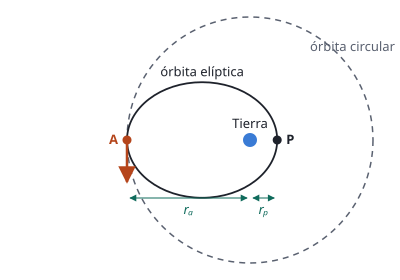

## Enunciado

Un satélite de 50 kg de masa describe inicialmente una órbita elíptica alrededor de la Tierra. Para obtener el periodo de la órbita se mide el tiempo de tránsito del satélite desde el perigeo (P) hasta el apogeo (A), encontrándose un valor de 55759,5 s. Se desea que pase a una órbita circular de radio $r_\text{cir} = 8{,}2\cdot 10^{4}\ \mathrm{km}$ alrededor de la Tierra, para lo cual se le proporciona un impulso instantáneo en la posición A (ver figura). Calcule:

1. (1,2 puntos) El periodo, el semieje mayor y la distancia del centro de la Tierra al perigeo en la órbita elíptica.
2. (0,6 puntos) La energía mecánica del satélite en la órbita elíptica sabiendo que la velocidad en el perigeo es igual a $6{,}0\ \mathrm{km\,s^{-1}}$.
3. (0,7 puntos) La energía mecánica del satélite en la órbita circular.

**Datos:** Constante de la Gravitación Universal, $G = 6{,}67\cdot 10^{-11}\ \mathrm{N\,m^2\,kg^{-2}}$; Masa de la Tierra, $M_T = 5{,}97\cdot 10^{24}\ \mathrm{kg}$.

## Datos

- Masa del satélite: $m = 50\ \mathrm{kg}$
- Tiempo de perigeo a apogeo: $55\,759{,}5\ \mathrm{s}$
- Radio de la órbita circular: $r_\text{cir} = 8{,}2\cdot 10^{4}\ \mathrm{km} = 8{,}2\cdot 10^{7}\ \mathrm{m}$
- Velocidad en el perigeo: $v_p = 6{,}0\ \mathrm{km\,s^{-1}} = 6{,}0\cdot 10^{3}\ \mathrm{m\,s^{-1}}$

## Planteamiento

Hay dos lecturas de la figura que resuelven el problema:

- La elipse es simétrica, así que ir del perigeo al apogeo es **media vuelta**: el periodo es el doble del tiempo medido.
- El impulso se da en A y la órbita circular pasa por A. Por tanto la distancia al apogeo de la elipse coincide con el radio de la órbita circular: $r_a = r_\text{cir}$.

Con el periodo, la tercera ley de Kepler da el semieje mayor, y como el eje mayor mide $r_a + r_p = 2a$, se despeja el perigeo. Las energías se calculan sumando cinética y potencial en un punto donde se conozcan las dos.

## Resolución

### a) Periodo, semieje mayor y distancia al perigeo

**Periodo.** De P a A el satélite recorre media órbita:

$$T = 2\cdot 55\,759{,}5 = 111\,519\ \mathrm{s} = 1{,}12\cdot 10^{5}\ \mathrm{s}$$

**Semieje mayor.** Tercera ley de Kepler:

$$\frac{T^2}{a^3} = \frac{4\pi^2}{G\,M_T}
\quad\Longrightarrow\quad
a = \sqrt[3]{\frac{G\,M_T\,T^2}{4\pi^2}}$$

$$\begin{aligned}
a &= \sqrt[3]{\frac{6{,}67\cdot 10^{-11}\cdot 5{,}97\cdot 10^{24}\cdot (1{,}115\cdot 10^{5})^2}{4\pi^2}} \\[4pt]
  &= 5{,}01\cdot 10^{7}\ \mathrm{m}
\end{aligned}$$

**Perigeo.** El eje mayor de la elipse va de A a P pasando por la Tierra, de modo que $r_a + r_p = 2a$. Con $r_a = r_\text{cir}$:

$$\begin{aligned}
r_p = 2a - r_a &= 2\cdot 5{,}01\cdot 10^{7} - 8{,}2\cdot 10^{7} \\[4pt]
               &= 1{,}81\cdot 10^{7}\ \mathrm{m}
\end{aligned}$$

### b) Energía mecánica en la órbita elíptica

La energía mecánica es la misma en toda la órbita. La calculamos en el perigeo, donde conocemos la velocidad y la distancia:

$$E_m = \frac12\,m\,v_p^2 - G\,\frac{M_T\,m}{r_p}$$

$$\begin{aligned}
E_m &= \frac12\cdot 50\cdot (6{,}0\cdot 10^{3})^2 - \frac{6{,}67\cdot 10^{-11}\cdot 5{,}97\cdot 10^{24}\cdot 50}{1{,}81\cdot 10^{7}} \\[4pt]
    &= 9{,}00\cdot 10^{8} - 1{,}099\cdot 10^{9} \\[4pt]
    &= -1{,}99\cdot 10^{8}\ \mathrm{J}
\end{aligned}$$

Es una resta de dos números parecidos, así que conviene guardar cuatro cifras en los términos intermedios.

### c) Energía mecánica en la órbita circular

En una órbita circular la velocidad cumple $v^2 = GM_T/r$, y la energía mecánica es la mitad de la potencial:

$$E_m = -\frac{G\,M_T\,m}{2\,r_\text{cir}}$$

$$\begin{aligned}
E_m &= -\frac{6{,}67\cdot 10^{-11}\cdot 5{,}97\cdot 10^{24}\cdot 50}{2\cdot 8{,}2\cdot 10^{7}} \\[4pt]
    &= -1{,}21\cdot 10^{8}\ \mathrm{J}
\end{aligned}$$

Es mayor (menos negativa) que la de la órbita elíptica. La diferencia, unos $7{,}8\cdot 10^{7}\ \mathrm{J}$, es la energía que aporta el impulso en A.

## Errores típicos

- Tomar 55 759,5 s como el periodo. Es solo media vuelta.
- Usar el radio de la órbita circular en la tercera ley para la elipse. En la elipse va el semieje mayor.
- Calcular la energía de la elipse con $-GMm/(2r_p)$, como si fuera circular de radio $r_p$.
- Dejar la velocidad en $\mathrm{km\,s^{-1}}$ o el radio en km.
