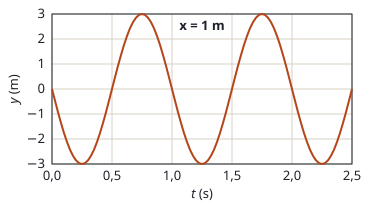
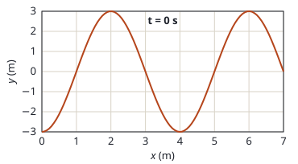

## Enunciado

Las siguientes gráficas muestran la oscilación de una onda armónica transversal que oscila en el eje $y$ en función del tiempo en $x = 1\ \mathrm{m}$, y la elongación en función de $x$ para el instante inicial. Si la onda se propaga en el sentido positivo del eje $x$, determine:

1. (1,6 puntos) El periodo, el número de onda, la amplitud y la longitud de onda.
2. (0,9 puntos) La expresión matemática de la onda.

## Datos

Lo que se lee en las gráficas:

- En $x = 1\ \mathrm{m}$ (primera gráfica): la oscilación se repite cada 1 s; en $t = 0$ la elongación es cero y **está bajando**.
- En $t = 0$ (segunda gráfica): el perfil se repite cada 4 m; en $x = 0$ la elongación es $-3\ \mathrm{m}$.
- En las dos, la elongación máxima es 3 m.

## Planteamiento

Cada gráfica da una de las dos periodicidades de la onda. La que tiene el **tiempo** en el eje horizontal da el periodo; la que tiene la **posición**, la longitud de onda. No hay que intercambiarlas.

Para la expresión se usa la forma general de una onda que avanza hacia las $x$ positivas, $y = A\operatorname{sen}(\omega t - kx + \varphi_0)$, y la fase inicial se ajusta con un punto de las gráficas en el que el valor no deje dudas.

## Resolución

### a) Periodo, número de onda, amplitud y longitud de onda

**Periodo.** En la gráfica $y$–$t$, una oscilación completa dura:

$$T = 1{,}00\ \mathrm{s}$$

**Longitud de onda.** En la gráfica $y$–$x$, el perfil se repite cada:

$$\lambda = 4{,}00\ \mathrm{m}$$

**Número de onda.**

$$k = \frac{2\pi}{\lambda} = \frac{2\pi}{4} = \frac{\pi}{2}\ \mathrm{rad\,m^{-1}} = 1{,}57\ \mathrm{rad\,m^{-1}}$$

**Amplitud.** Es la elongación máxima, en cualquiera de las dos gráficas:

$$A = 3{,}00\ \mathrm{m}$$

### b) Expresión matemática de la onda

La frecuencia angular es:

$$\omega = \frac{2\pi}{T} = 2\pi\ \mathrm{rad\,s^{-1}}$$

Como la onda avanza hacia las $x$ positivas, $\omega t$ y $kx$ llevan signos opuestos:

$$y(x,t) = 3\operatorname{sen}\left(2\pi t - \frac{\pi}{2}\,x + \varphi_0\right)$$

Para la fase inicial usamos el punto $x = 0$, $t = 0$, donde la segunda gráfica marca $y = -3\ \mathrm{m}$, es decir, $-A$:

$$-3 = 3\operatorname{sen}\varphi_0
\quad\Longrightarrow\quad
\operatorname{sen}\varphi_0 = -1
\quad\Longrightarrow\quad
\varphi_0 = \frac{3\pi}{2}$$

Elegir un punto donde la elongación es máxima o mínima tiene una ventaja: el seno solo vale $-1$ para un ángulo, y no hay que decidir entre dos soluciones.

$$y(x,t) = 3\operatorname{sen}\left(2\pi t - \frac{\pi}{2}\,x + \frac{3\pi}{2}\right)$$

con $x$ e $y$ en metros y $t$ en segundos.

**Comprobación** con la primera gráfica. En $x = 1\ \mathrm{m}$ y $t = 0$ la fase es $-\pi/2 + 3\pi/2 = \pi$, y $\operatorname{sen}\pi = 0$: correcto. Un cuarto de periodo después, en $t = 0{,}25\ \mathrm{s}$, la fase es $3\pi/2$ y $y = -3\ \mathrm{m}$: la elongación baja, como en la gráfica.

La misma onda puede escribirse con $\varphi_0 = -\pi/2$ o, usando el coseno, como $y = 3\cos\left(2\pi t - \tfrac{\pi}{2}x + \pi\right)$.

## Errores típicos

- Leer el periodo en la gráfica de $x$ o la longitud de onda en la de $t$.
- Ajustar la fase con un punto donde $y = 0$ y quedarse con la primera solución. Con $y = 0$ hay dos fases posibles ($\pi/2$ y $3\pi/2$ en este caso) y hay que usar además si la elongación sube o baja.
- Poner signo más entre $\omega t$ y $kx$: esa onda viajaría hacia las $x$ negativas.
- Olvidar indicar las unidades de $x$, $y$ y $t$ en la expresión final.
