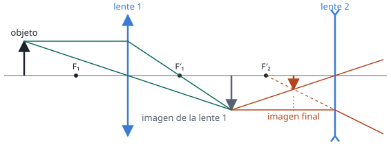

## Enunciado

Un sistema óptico está formado por dos lentes, la primera convergente de distancia focal 15 cm, y la segunda divergente con una distancia focal de 20 cm. Ambas lentes están separadas una distancia de 60 cm. Si a 30 cm a la izquierda de la primera lente se sitúa un objeto de 10 cm de altura:

1. (1,5 puntos) Calcule la posición, el tamaño y la naturaleza de la imagen final.
2. (1 punto) Realice el trazado de rayos de la formación de imagen a través del sistema óptico.

## Datos

Con el criterio de signos DIN (distancias positivas hacia la derecha, medidas desde cada lente):

- Lente 1, convergente: $f'_1 = +15\ \mathrm{cm}$
- Lente 2, divergente: $f'_2 = -20\ \mathrm{cm}$
- Separación entre lentes: $60\ \mathrm{cm}$
- Objeto: $s_1 = -30\ \mathrm{cm}$, $y = 10\ \mathrm{cm}$

## Planteamiento

Un sistema de dos lentes se resuelve en dos pasos. Primero se calcula la imagen que forma la primera lente, como si la segunda no existiera. Esa imagen hace de **objeto para la segunda lente**, y lo único delicado es medir su posición desde la segunda lente, no desde la primera.

El aumento total es el producto de los aumentos de cada lente.

## Resolución

### a) Posición, tamaño y naturaleza de la imagen final

**Primera lente.**

$$\frac{1}{s'_1} - \frac{1}{s_1} = \frac{1}{f'_1}
\quad\Longrightarrow\quad
\frac{1}{s'_1} = \frac{1}{15} + \frac{1}{-30} = \frac{1}{30}$$

$$s'_1 = 30\ \mathrm{cm}$$

La imagen intermedia se forma 30 cm a la derecha de la primera lente. Es lo esperado: el objeto está a $2f'_1$ y la imagen sale también a $2f'_1$, real, invertida y del mismo tamaño.

**Objeto para la segunda lente.** La segunda lente está a 60 cm de la primera, y la imagen intermedia a 30 cm. Queda por tanto 30 cm **a la izquierda** de la segunda lente:

$$s_2 = 30 - 60 = -30\ \mathrm{cm}$$

**Segunda lente.**

$$\frac{1}{s'_2} = \frac{1}{f'_2} + \frac{1}{s_2} = \frac{1}{-20} + \frac{1}{-30} = -\frac{5}{60}$$

$$s'_2 = -12{,}0\ \mathrm{cm}$$

La imagen final está 12 cm a la izquierda de la lente divergente, es decir, a 48 cm de la primera lente.

**Tamaño.** Aumento de cada lente y aumento total:

$$M_1 = \frac{s'_1}{s_1} = \frac{30}{-30} = -1
\qquad
M_2 = \frac{s'_2}{s_2} = \frac{-12}{-30} = 0{,}4$$

$$M = M_1\,M_2 = -0{,}4
\quad\Longrightarrow\quad
y' = M\,y = -0{,}4\cdot 10 = -4{,}00\ \mathrm{cm}$$

**Naturaleza.** La imagen final es:

- **virtual**, porque $s'_2 < 0$: queda al mismo lado de la segunda lente por el que llega la luz, y los rayos no se cruzan realmente allí;
- **invertida** respecto al objeto original, porque $M < 0$;
- **menor**, de 4 cm frente a los 10 cm del objeto.

### b) Trazado de rayos

Se dibuja en dos etapas, igual que el cálculo.

- **Lente 1.** Desde el extremo del objeto: el rayo paralelo al eje sale por el foco imagen $F'_1$, y el rayo que pasa por el centro no se desvía. Se cortan en el extremo de la imagen intermedia.
- **Lente 2.** Desde el extremo de la imagen intermedia: el rayo paralelo al eje sale divergiendo, como si viniera del foco imagen $F'_2$, que en una lente divergente está a su **izquierda**; el rayo que pasa por el centro no se desvía. Los rayos que salen no se cortan, pero sus prolongaciones hacia atrás (línea de puntos) sí: ahí está la imagen virtual.

## Errores típicos

- Usar para la segunda lente la distancia medida desde la primera ($s_2 = 30\ \mathrm{cm}$) en lugar de $-30\ \mathrm{cm}$.
- Poner la focal de la lente divergente como positiva. El enunciado da «20 cm» y el signo hay que añadirlo.
- Decir que la imagen final es derecha porque $M_2 > 0$. La segunda lente no invierte, pero la primera sí: cuenta el aumento total.
- Sumar los aumentos en vez de multiplicarlos.
