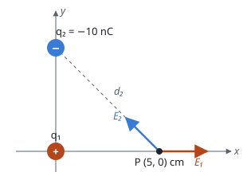

## Enunciado

Una carga positiva $q_1$ se halla situada en el origen de coordenadas del plano $xy$. En un punto P situado en el eje $x$ y a una distancia desconocida del origen, el potencial eléctrico debido a dicha carga es de $9\cdot 10^{2}\ \mathrm{V}$ y el módulo del campo eléctrico en esa misma posición es de $1{,}8\cdot 10^{4}\ \mathrm{N\,C^{-1}}$.

1. (1,6 puntos) Calcule el valor de la carga $q_1$ y la distancia $d_1$ que hay entre la carga y el punto P.
2. (0,9 puntos) Si a continuación, manteniendo la carga $q_1$ en el origen de coordenadas, situamos una segunda carga, $q_2$, de $-10\ \mathrm{nC}$ en la posición $(0, 5)\ \mathrm{cm}$ del plano $xy$, determine el vector campo eléctrico en la posición $(5, 0)\ \mathrm{cm}$.

**Dato:** Constante de Coulomb, $K = 9\cdot 10^{9}\ \mathrm{N\,m^2\,C^{-2}}$.

## Datos

- Potencial en P: $V = 9\cdot 10^{2}\ \mathrm{V}$
- Campo en P: $E = 1{,}8\cdot 10^{4}\ \mathrm{N\,C^{-1}}$
- Segunda carga: $q_2 = -10\ \mathrm{nC} = -1{,}0\cdot 10^{-8}\ \mathrm{C}$ en $(0;\ 0{,}05)\ \mathrm{m}$

## Planteamiento

Hay dos incógnitas, la carga y la distancia, y dos datos, el potencial y el campo. Las dos expresiones se parecen mucho: el potencial va con $1/d$ y el campo con $1/d^2$. Al **dividir una entre otra** desaparece la carga y queda la distancia.

En el segundo apartado el punto $(5, 0)\ \mathrm{cm}$ resulta ser el propio punto P, así que el campo de $q_1$ ya se conoce. Solo falta el de $q_2$, que es negativa y por tanto atrae: su campo apunta hacia ella.

## Resolución

### a) Carga y distancia

Potencial y campo de una carga puntual positiva a distancia $d_1$:

$$V = K\,\frac{q_1}{d_1} \qquad\qquad E = K\,\frac{q_1}{d_1^2}$$

Dividiendo la primera entre la segunda:

$$\frac{V}{E} = d_1
\quad\Longrightarrow\quad
d_1 = \frac{9\cdot 10^{2}}{1{,}8\cdot 10^{4}} = 5{,}00\cdot 10^{-2}\ \mathrm{m}$$

El punto P está a 5 cm de la carga. Con la distancia, la carga sale del potencial:

$$q_1 = \frac{V\,d_1}{K} = \frac{9\cdot 10^{2}\cdot 5{,}00\cdot 10^{-2}}{9\cdot 10^{9}} = 5{,}00\cdot 10^{-9}\ \mathrm{C}$$

Es decir, $q_1 = 5\ \mathrm{nC}$.

### b) Campo en (5, 0) cm con las dos cargas

**Campo de $q_1$.** El punto está a 5 cm del origen sobre el eje $x$: es el punto P, donde el módulo ya es dato. Como $q_1$ es positiva, el campo se aleja de ella:

$$\vec E_1 = 1{,}80\cdot 10^{4}\,\vec i\ \ \mathrm{N\,C^{-1}}$$

**Campo de $q_2$.** Distancia de $(0, 5)$ a $(5, 0)$ cm:

$$d_2 = \sqrt{5^2 + 5^2} = 7{,}07\ \mathrm{cm}
\quad\Longrightarrow\quad
d_2^2 = 50\ \mathrm{cm^2} = 5{,}0\cdot 10^{-3}\ \mathrm{m^2}$$

$$E_2 = K\,\frac{|q_2|}{d_2^2} = \frac{9\cdot 10^{9}\cdot 1{,}0\cdot 10^{-8}}{5{,}0\cdot 10^{-3}} = 1{,}80\cdot 10^{4}\ \mathrm{N\,C^{-1}}$$

Como $q_2$ es negativa, el campo apunta de P hacia ella: 5 cm a la izquierda y 5 cm hacia arriba, a 45°. Sus componentes son:

$$\begin{aligned}
\vec E_2 &= E_2\,(-\cos 45^\circ\,\vec i + \operatorname{sen} 45^\circ\,\vec j) \\[4pt]
         &= (-1{,}27\cdot 10^{4}\,\vec i + 1{,}27\cdot 10^{4}\,\vec j)\ \ \mathrm{N\,C^{-1}}
\end{aligned}$$

**Campo total.**

$$\begin{aligned}
\vec E &= \vec E_1 + \vec E_2 \\[4pt]
       &= (5{,}27\cdot 10^{3}\,\vec i + 1{,}27\cdot 10^{4}\,\vec j)\ \ \mathrm{N\,C^{-1}}
\end{aligned}$$

## Errores típicos

- Intentar despejar con una sola ecuación. Hacen falta las dos, y dividirlas es el camino corto.
- Dejar los 5 cm sin pasar a metros al calcular el campo de $q_2$.
- Dibujar el campo de $q_2$ alejándose de ella. Es negativa: el campo va hacia la carga.
- Sumar los módulos, $1{,}8\cdot 10^{4} + 1{,}8\cdot 10^{4}$, en lugar de las componentes.
