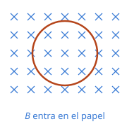
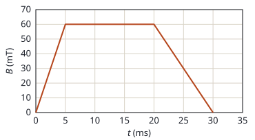

## Enunciado

Una espira circular de área $S = 10\ \mathrm{cm^2}$ se sitúa perpendicular a un campo magnético $\vec B$ tal y como se muestra en la Figura (a). Por otra parte, en la Figura (b) se muestra la variación con el tiempo del campo magnético.

1. (1,5 puntos) Calcule la fuerza electromotriz inducida en la espira en los intervalos de tiempo (0, 5) ms, (5, 20) ms y (20, 30) ms.
2. (1 punto) Si la resistencia de la espira es de $2\ \Omega$, determine la intensidad de corriente eléctrica, indicando el sentido de esta, para los intervalos de tiempo (0, 5) ms y (20, 30) ms.

## Datos

- Área de la espira: $S = 10\ \mathrm{cm^2} = 1{,}0\cdot 10^{-3}\ \mathrm{m^2}$
- Resistencia: $R = 2\ \Omega$
- El campo entra en el papel y es perpendicular a la espira
- De la gráfica: $B$ pasa de 0 a $60\ \mathrm{mT}$ en $5\ \mathrm{ms}$, se mantiene constante 15 ms y baja de $60\ \mathrm{mT}$ a 0 en $10\ \mathrm{ms}$

## Planteamiento

La espira no se mueve ni cambia de forma. Lo único que hace variar el flujo es el propio campo, así que la fem depende de la **pendiente** de la gráfica $B$–$t$ en cada tramo:

$$\Phi = B\,S
\quad\Longrightarrow\quad
\varepsilon = -\frac{\mathrm{d}\Phi}{\mathrm{d}t} = -S\,\frac{\mathrm{d}B}{\mathrm{d}t}$$

Como los tres tramos son rectas, la derivada es simplemente $\Delta B/\Delta t$. El sentido de la corriente se decide con la ley de Lenz.

## Resolución

### a) Fuerza electromotriz en cada intervalo

Tomamos la normal a la espira en el sentido del campo (entrando en el papel), de modo que el flujo es positivo.

**Intervalo (0, 5) ms.** El campo crece:

$$\frac{\Delta B}{\Delta t} = \frac{60\cdot 10^{-3} - 0}{5\cdot 10^{-3}} = 12\ \mathrm{T\,s^{-1}}$$

$$\varepsilon = -S\,\frac{\Delta B}{\Delta t} = -1{,}0\cdot 10^{-3}\cdot 12 = -12{,}0\ \mathrm{mV}$$

**Intervalo (5, 20) ms.** El campo vale 60 mT todo el tiempo. Hay flujo, pero no cambia:

$$\varepsilon = 0$$

**Intervalo (20, 30) ms.** El campo decrece:

$$\frac{\Delta B}{\Delta t} = \frac{0 - 60\cdot 10^{-3}}{10\cdot 10^{-3}} = -6\ \mathrm{T\,s^{-1}}$$

$$\varepsilon = -1{,}0\cdot 10^{-3}\cdot (-6) = +6{,}00\ \mathrm{mV}$$

Los signos dependen del sentido elegido para la normal; lo que tiene significado físico es que las fem de los tramos primero y tercero son **opuestas**, y que la primera es el doble porque el campo cambia el doble de rápido.

### b) Intensidad y sentido de la corriente

Por la ley de Ohm, $I = |\varepsilon|/R$.

**Intervalo (0, 5) ms.**

$$I = \frac{12{,}0\cdot 10^{-3}}{2} = 6{,}00\cdot 10^{-3}\ \mathrm{A} = 6{,}00\ \mathrm{mA}$$

El flujo entrante está **aumentando**. La corriente inducida se opone creando un campo saliente, y para eso tiene que circular en **sentido antihorario** (regla de la mano derecha).

**Intervalo (20, 30) ms.**

$$I = \frac{6{,}00\cdot 10^{-3}}{2} = 3{,}00\cdot 10^{-3}\ \mathrm{A} = 3{,}00\ \mathrm{mA}$$

Ahora el flujo entrante está **disminuyendo**. La corriente inducida intenta mantenerlo creando un campo también entrante: circula en **sentido horario**.

## Errores típicos

- Decir que en (5, 20) ms hay fem porque el campo es máximo. La fem depende de cómo cambia el flujo, no de cuánto vale.
- No convertir el área: $10\ \mathrm{cm^2}$ son $10^{-3}\ \mathrm{m^2}$, no $10^{-1}$.
- Leer mal la duración del último tramo: son 10 ms, no 30.
- Aplicar Lenz como «la corriente crea un campo contrario a $B$». Se opone al **cambio** del flujo: si el flujo disminuye, el campo inducido va a favor de $B$.
