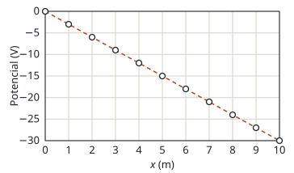

## Enunciado

Se han colocado dos placas paralelas perpendiculares a la dirección $x$. Una de ellas se ha cargado con carga positiva y la otra con igual carga, pero de signo negativo. Mediante una sonda se ha medido el potencial electrostático en la región entre las placas $0 \le x \le 10\ \mathrm{m}$. Los valores del potencial se representan en la figura. A partir de ella se ha determinado que el potencial electrostático en el intervalo $0 \le x \le 10\ \mathrm{m}$ viene dado por la expresión:

$$V(x) = -3x$$

donde $x$ está expresado en metros y $V$ en voltios. La intensidad del campo eléctrico está relacionada con el potencial, para el caso unidimensional, mediante la expresión:

$$E(x) = -\frac{\mathrm{d}V}{\mathrm{d}x}$$

1. (1 punto) Calcule el campo eléctrico en el intervalo $0 \le x \le 10\ \mathrm{m}$.
2. (0,5 puntos) Determine la aceleración que tendría una carga de 10 nC y masa $6\cdot 10^{-10}\ \mathrm{kg}$ que se situara en el punto $x = 5\ \mathrm{m}$.
3. (1 punto) Si la carga de 10 nC y masa $6\cdot 10^{-10}\ \mathrm{kg}$ se deja en reposo en el origen de coordenadas determine su velocidad en el punto $x = 5\ \mathrm{m}$.

## Datos

- Potencial: $V(x) = -3x$ (V, con $x$ en m)
- Carga: $q = 10\ \mathrm{nC} = 1{,}0\cdot 10^{-8}\ \mathrm{C}$
- Masa: $m = 6\cdot 10^{-10}\ \mathrm{kg}$

## Planteamiento

El potencial es una recta, así que su derivada es constante: el campo es **uniforme**, como corresponde a dos placas paralelas. Un campo uniforme ejerce una fuerza constante, y la carga se mueve con aceleración constante.

Para la velocidad lo más directo es la conservación de la energía: lo que la carga pierde de energía potencial eléctrica al pasar de $x = 0$ a $x = 5\ \mathrm{m}$ lo gana de energía cinética.

## Resolución

### a) Campo eléctrico

$$E = -\frac{\mathrm{d}V}{\mathrm{d}x} = -\frac{\mathrm{d}(-3x)}{\mathrm{d}x} = 3{,}00\ \mathrm{V\,m^{-1}}$$

El campo vale lo mismo en todos los puntos entre las placas. Es positivo: apunta en el sentido positivo del eje $x$, que es el sentido en que el potencial **disminuye**. Vectorialmente, $\vec E = 3\,\vec i\ \mathrm{V\,m^{-1}}$ (o $\mathrm{N\,C^{-1}}$, que es la misma unidad).

En la gráfica, el campo es la pendiente de la recta cambiada de signo: baja 30 V en 10 m.

### b) Aceleración de la carga

La fuerza eléctrica es la única que actúa. Por la segunda ley de Newton:

$$q\,E = m\,a
\quad\Longrightarrow\quad
a = \frac{q\,E}{m} = \frac{1{,}0\cdot 10^{-8}\cdot 3}{6\cdot 10^{-10}} = 50{,}0\ \mathrm{m\,s^{-2}}$$

Como la carga es positiva, la aceleración tiene el sentido del campo, hacia las $x$ positivas. Al ser el campo uniforme, la aceleración es la misma en $x = 5\ \mathrm{m}$ que en cualquier otro punto.

### c) Velocidad en x = 5 m

La fuerza eléctrica es conservativa. La energía mecánica es la misma en el origen y en $x = 5\ \mathrm{m}$:

$$\frac12\,m\,v_0^2 + q\,V(0) = \frac12\,m\,v^2 + q\,V(5)$$

En el origen la carga está en reposo y el potencial es cero, de modo que todo el primer miembro se anula. Con $V(5) = -3\cdot 5 = -15\ \mathrm{V}$:

$$\frac12\,m\,v^2 = -q\,V(5)
\quad\Longrightarrow\quad
v = \sqrt{\frac{-2\,q\,V(5)}{m}}$$

$$v = \sqrt{\frac{2\cdot 1{,}0\cdot 10^{-8}\cdot 15}{6\cdot 10^{-10}}} = \sqrt{500} = 22{,}4\ \mathrm{m\,s^{-1}}$$

**Comprobación** por cinemática. Con aceleración constante y partiendo del reposo, $v^2 = 2\,a\,\Delta x = 2\cdot 50\cdot 5 = 500$: el mismo resultado.

## Errores típicos

- Olvidar el signo menos de $E = -\mathrm{d}V/\mathrm{d}x$ y obtener un campo hacia la izquierda.
- Sustituir $x = 5$ en el campo como si dependiera de la posición. El campo es constante.
- Dejar la carga en nC.
- En el apartado c, escribir $\tfrac12 m v^2 = q\,V(5)$ sin el signo: saldría una energía cinética negativa.
