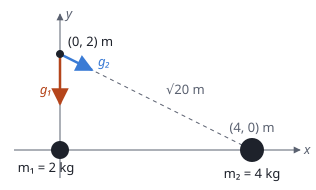

## Enunciado

Dos masas puntuales, $m_1 = 2\ \mathrm{kg}$ y $m_2 = 4\ \mathrm{kg}$ están situadas en el origen de coordenadas y en el punto $(4, 0)\ \mathrm{m}$ del plano $xy$, respectivamente. Calcule:

1. (1,5 puntos) El punto del eje $x$ entre ambas masas en el que el campo gravitatorio creado por las dos masas es nulo.
2. (1 punto) El campo gravitatorio total debido a ambas masas en el punto $(0, 2)\ \mathrm{m}$.

**Dato:** Constante de la Gravitación Universal, $G = 6{,}67\cdot 10^{-11}\ \mathrm{N\,m^2\,kg^{-2}}$.

## Datos

- $m_1 = 2\ \mathrm{kg}$ en $(0, 0)$
- $m_2 = 4\ \mathrm{kg}$ en $(4, 0)\ \mathrm{m}$

## Planteamiento

El campo gravitatorio de una masa apunta siempre **hacia ella**. En un punto del eje $x$ situado entre las dos, el campo de $m_1$ va hacia la izquierda y el de $m_2$ hacia la derecha: tienen sentidos opuestos y se anulan donde sus módulos coinciden. Ese punto estará más cerca de la masa pequeña.

En el punto $(0, 2)\ \mathrm{m}$ los dos campos no están alineados y hay que sumar vectores por componentes.

## Resolución

### a) Punto del eje x donde el campo es nulo

Sea $x$ la distancia del punto a $m_1$; su distancia a $m_2$ es $4 - x$. Igualamos los módulos:

$$G\,\frac{m_1}{x^2} = G\,\frac{m_2}{(4 - x)^2}
\quad\Longrightarrow\quad
\frac{(4 - x)^2}{x^2} = \frac{m_2}{m_1} = 2$$

Como el punto está entre las masas, $x$ y $4 - x$ son positivos y se puede tomar la raíz cuadrada en los dos miembros sin ambigüedad de signos:

$$\frac{4 - x}{x} = \sqrt 2
\quad\Longrightarrow\quad
x = \frac{4}{1 + \sqrt 2} = 1{,}66\ \mathrm{m}$$

El campo se anula en el punto $(1{,}66;\ 0)\ \mathrm{m}$, más cerca de la masa menor, como se esperaba.

Si en lugar de la raíz se desarrolla el cuadrado, se llega a la ecuación $x^2 + 8x - 16 = 0$, con soluciones $1{,}66$ y $-9{,}66\ \mathrm{m}$. La segunda no está entre las masas y se descarta: allí los módulos son iguales, pero los dos campos apuntan hacia el mismo lado y se suman.

### b) Campo en el punto (0, 2) m

**Campo de $m_1$.** Está a 2 m, justo debajo del punto, y el campo apunta hacia ella:

$$g_1 = G\,\frac{m_1}{r_1^2} = \frac{6{,}67\cdot 10^{-11}\cdot 2}{2^2} = 3{,}34\cdot 10^{-11}\ \mathrm{N\,kg^{-1}}$$

$$\vec g_1 = -3{,}34\cdot 10^{-11}\,\vec j\ \ \mathrm{N\,kg^{-1}}$$

**Campo de $m_2$.** La distancia es $r_2 = \sqrt{4^2 + 2^2} = \sqrt{20}\ \mathrm{m}$:

$$g_2 = G\,\frac{m_2}{r_2^2} = \frac{6{,}67\cdot 10^{-11}\cdot 4}{20} = 1{,}33\cdot 10^{-11}\ \mathrm{N\,kg^{-1}}$$

Apunta del punto hacia $m_2$: 4 m hacia la derecha y 2 m hacia abajo. Con $\cos\theta = 4/\sqrt{20}$ y $\operatorname{sen}\theta = 2/\sqrt{20}$:

$$\begin{aligned}
\vec g_2 &= g_2\,(\cos\theta\,\vec i - \operatorname{sen}\theta\,\vec j) \\[4pt]
         &= (1{,}19\cdot 10^{-11}\,\vec i - 0{,}60\cdot 10^{-11}\,\vec j)\ \ \mathrm{N\,kg^{-1}}
\end{aligned}$$

**Campo total.**

$$\begin{aligned}
\vec g &= \vec g_1 + \vec g_2 \\[4pt]
       &= (1{,}19\cdot 10^{-11}\,\vec i - 3{,}93\cdot 10^{-11}\,\vec j)\ \ \mathrm{N\,kg^{-1}}
\end{aligned}$$

Su módulo es $4{,}11\cdot 10^{-11}\ \mathrm{N\,kg^{-1}}$. La componente $y$ sale $-3{,}93$ o $-3{,}94$ según se redondeen los sumandos; cualquiera de las dos es correcta.

## Errores típicos

- Quedarse con la solución negativa de la ecuación de segundo grado, o dar las dos.
- Colocar el punto de campo nulo más cerca de la masa grande.
- Dibujar los campos alejándose de las masas, como si fueran cargas positivas. El campo gravitatorio siempre es atractivo.
- Usar la distancia $r_2 = \sqrt{20}$ sin elevarla al cuadrado, o elevarla dos veces.
