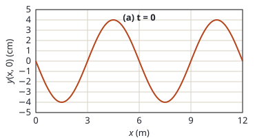
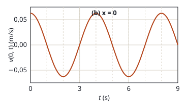

## Enunciado

La ecuación de una onda transversal que se propaga a lo largo de la dirección positiva del eje $x$ viene dada por la expresión $y(x,t) = A\operatorname{sen}(\omega t - kx + \phi)$. En la figura (a) se representa el desplazamiento de los diferentes puntos del medio en el instante $t = 0$. En la figura (b) se representa la velocidad de oscilación del punto $x = 0$ del medio en función del tiempo. Determine:

1. (1 punto) La amplitud de la onda $A$ y el número de ondas $k$.
2. (1 punto) La fase de la onda $\phi$ y el valor máximo de la velocidad de oscilación.
3. (0,5 puntos) La velocidad de propagación de la onda.

## Datos

Lo que se lee en las gráficas:

- Figura (a), perfil en $t = 0$: elongación máxima de 4 cm; el perfil se repite cada 6 m; en $x = 0$ la elongación es cero.
- Figura (b), velocidad en $x = 0$: se repite cada 4 s; en $t = 0$ la velocidad es **máxima y positiva**.

## Planteamiento

La figura (a) tiene la posición en el eje horizontal: da la amplitud y la longitud de onda. La figura (b) tiene el tiempo: da el periodo. Atención a que la figura (b) no representa la elongación sino la **velocidad de oscilación**, que es la derivada de $y$ respecto al tiempo:

$$v_y(x,t) = \frac{\partial y}{\partial t} = A\,\omega\cos(\omega t - kx + \phi)$$

La fase se fija con lo que ocurre en $x = 0$, $t = 0$, usando las dos gráficas.

## Resolución

### a) Amplitud y número de ondas

De la figura (a), el desplazamiento máximo es:

$$A = 4\ \mathrm{cm} = 4{,}00\cdot 10^{-2}\ \mathrm{m}$$

La distancia entre dos máximos consecutivos (de $x = 4{,}5\ \mathrm{m}$ a $x = 10{,}5\ \mathrm{m}$) es la longitud de onda, $\lambda = 6\ \mathrm{m}$. Por tanto:

$$k = \frac{2\pi}{\lambda} = \frac{2\pi}{6} = \frac{\pi}{3}\ \mathrm{rad\,m^{-1}} = 1{,}05\ \mathrm{rad\,m^{-1}}$$

### b) Fase y velocidad máxima de oscilación

**Fase.** En $x = 0$ y $t = 0$ la figura (a) da elongación nula:

$$y(0,0) = A\operatorname{sen}\phi = 0
\quad\Longrightarrow\quad
\phi = 0 \ \text{ o } \ \phi = \pi$$

Para decidir entre las dos se usa la figura (b): en ese mismo punto e instante la velocidad es positiva.

$$v_y(0,0) = A\,\omega\cos\phi > 0
\quad\Longrightarrow\quad
\phi = 0$$

(con $\phi = \pi$ el coseno valdría $-1$ y la velocidad sería negativa).

**Velocidad máxima.** De la figura (b), el periodo es $T = 4\ \mathrm{s}$, y la frecuencia angular:

$$\omega = \frac{2\pi}{T} = \frac{\pi}{2}\ \mathrm{rad\,s^{-1}}$$

El valor máximo de la velocidad de oscilación es el factor que multiplica al coseno:

$$v_\text{máx} = A\,\omega = 4{,}00\cdot 10^{-2}\cdot\frac{\pi}{2} = 6{,}28\cdot 10^{-2}\ \mathrm{m\,s^{-1}}$$

Coincide con el máximo que se lee en la figura (b), algo por encima de 0,06.

### c) Velocidad de propagación

$$v = \frac{\lambda}{T} = \frac{6}{4} = 1{,}50\ \mathrm{m\,s^{-1}}$$

No tiene nada que ver con la velocidad del apartado anterior: esta es la rapidez con que avanza la onda, constante; aquella, la de cada punto del medio al subir y bajar. La onda queda:

$$y(x,t) = 0{,}04\operatorname{sen}\left(\frac{\pi}{2}\,t - \frac{\pi}{3}\,x\right)\quad \text{(SI)}$$

## Errores típicos

- Tomar el máximo de la figura (b) como amplitud. Esa gráfica es de velocidad.
- Quedarse con $\phi = \pi$ o no justificar por qué se descarta.
- Dejar la amplitud en centímetros al calcular la velocidad máxima.
- Confundir velocidad de oscilación y velocidad de propagación.
