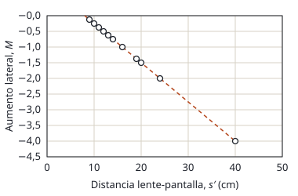
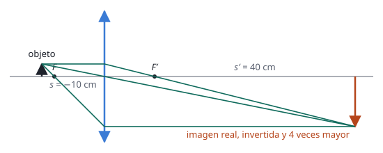

## Enunciado

Un sistema óptico está compuesto por un foco luminoso, un objeto iluminado por este, una lente y una pantalla. Se va cambiando la distancia $s$ entre el objeto y la lente y se busca la posición de la pantalla en la que la imagen está enfocada. La gráfica adjunta muestra la relación entre el aumento lateral $M$ y la distancia $s'$ entre la lente y la pantalla.

1. (1 punto) Demuestre que el aumento lateral, $M$, tiene la siguiente expresión en función de la distancia focal imagen, $f'$, y de la posición de la imagen, $s'$: $M = 1 - \dfrac{s'}{f'}$
2. (0,5 puntos) Con los datos de la gráfica, determine la distancia focal de la lente, razonando si es convergente o divergente.
3. (1 punto) Determine la distancia objeto para el caso en que la distancia lente-imagen es 40 cm y el aumento lateral es igual a −4. Realice el trazado de rayos en esta situación.

## Datos

- Un punto de la gráfica: $s' = 40\ \mathrm{cm}$, $M = -4$
- Criterio de signos DIN: distancias positivas a la derecha de la lente

## Planteamiento

Todo el problema sale de las dos ecuaciones de las lentes delgadas: la que relaciona las posiciones de objeto e imagen y la del aumento lateral. En el primer apartado se elimina $s$ entre las dos. La expresión que resulta es una recta en la gráfica $M$–$s'$, y de cualquier punto de esa recta se obtiene la distancia focal.

## Resolución

### a) Expresión del aumento lateral

Partimos de las dos ecuaciones de la lente delgada:

$$\frac{1}{s'} - \frac{1}{s} = \frac{1}{f'} \qquad\qquad M = \frac{s'}{s}$$

De la segunda despejamos el inverso de la distancia objeto:

$$\frac{1}{s} = \frac{M}{s'}$$

y lo sustituimos en la primera:

$$\frac{1}{s'} - \frac{M}{s'} = \frac{1}{f'}
\quad\Longrightarrow\quad
\frac{1 - M}{s'} = \frac{1}{f'}$$

Despejando $M$:

$$1 - M = \frac{s'}{f'}
\quad\Longrightarrow\quad
M = 1 - \frac{s'}{f'}$$

Es la ecuación de una recta de pendiente $-1/f'$ que corta al eje horizontal ($M = 0$) en $s' = f'$, justo lo que muestra la gráfica.

### b) Distancia focal y tipo de lente

Despejamos $f'$ de la expresión anterior y usamos el punto $s' = 40\ \mathrm{cm}$, $M = -4$:

$$f' = \frac{s'}{1 - M} = \frac{40}{1 - (-4)} = 8{,}00\ \mathrm{cm}$$

Se puede comprobar con otro punto de la gráfica: para $s' = 20\ \mathrm{cm}$ se lee $M = -1{,}5$, y $20/2{,}5 = 8\ \mathrm{cm}$. También coincide con el corte de la recta con el eje, en $s' = 8\ \mathrm{cm}$.

Como $f' > 0$, la lente es **convergente**. Se llega a la misma conclusión sin cuentas: la imagen se recoge en una pantalla, así que es real, y una lente divergente solo da imágenes virtuales.

### c) Distancia objeto y trazado de rayos

Del aumento lateral:

$$s = \frac{s'}{M} = \frac{40}{-4} = -10{,}0\ \mathrm{cm}$$

El signo negativo indica que el objeto está a la izquierda de la lente, a 10 cm. Está entre $f'$ y $2f'$ (entre 8 y 16 cm), y por eso la imagen es real, invertida ($M < 0$) y mayor que el objeto ($|M| = 4$).

Para el trazado se dibujan los rayos que salen del extremo del objeto:

- el que llega paralelo al eje sale pasando por el foco imagen $F'$;
- el que pasa por el centro de la lente no se desvía;
- el que pasa por el foco objeto $F$ sale paralelo al eje.

Los tres se cortan en el extremo de la imagen, a 40 cm de la lente.

## Errores típicos

- Escribir la ecuación de la lente con signo más, $1/s' + 1/s = 1/f'$. Con el criterio DIN lleva signo menos, y $s$ es negativa.
- Leer en la gráfica un punto poco claro. Conviene elegir uno que caiga sobre un cruce de la cuadrícula, como $(40, -4)$ o $(20, -1{,}5)$.
- Dar la distancia objeto como $+10\ \mathrm{cm}$. Si se quiere dar en valor absoluto hay que decirlo: «a 10 cm delante de la lente».
- Hacer el trazado sin escala. Si el dibujo respeta las distancias, sirve de comprobación del resultado.
