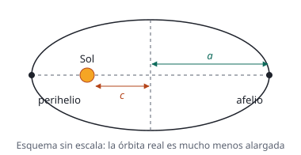

## Enunciado

Plutón es un planeta enano del sistema solar que describe una órbita con un periodo de 248 años terrestres. Sabiendo que la órbita de Plutón es elíptica y que la excentricidad de la órbita, es decir, el cociente entre la distancia del Sol al centro de la elipse, $c$, y el semieje mayor de la elipse, $a$, es 0,244, determine:

1. (1 punto) La distancia al Sol en la que Plutón está más alejado del mismo (afelio) y en la que está más cercano (perihelio).
2. (1,5 puntos) Las velocidades orbitales en el afelio y en el perihelio.

**Datos:** Constante de la Gravitación Universal, $G = 6{,}67\cdot 10^{-11}\ \mathrm{N\,m^2\,kg^{-2}}$; Masa del Sol, $M_{Sol} = 1{,}99\cdot 10^{30}\ \mathrm{kg}$.

## Datos

- Periodo, con años de 365 días:

$$T = 248\cdot 365\cdot 24\cdot 3600 = 7{,}82\cdot 10^{9}\ \mathrm{s}$$

- Excentricidad: $e = c/a = 0{,}244$
- Masa del Sol: $M = 1{,}99\cdot 10^{30}\ \mathrm{kg}$

## Planteamiento

El periodo da el tamaño de la órbita: la tercera ley de Kepler relaciona $T$ con el semieje mayor $a$. Con $a$ y la excentricidad se obtiene $c$, y mirando la figura, las dos distancias extremas son $a - c$ y $a + c$.

Para las velocidades hay dos incógnitas y hacen falta dos ecuaciones. Entre el perihelio y el afelio se conservan dos magnitudes: el **momento angular**, porque la fuerza gravitatoria es central, y la **energía mecánica**, porque es conservativa.

## Resolución

### a) Distancias en el afelio y el perihelio

La tercera ley de Kepler, con el semieje mayor en el lugar del radio:

$$\frac{T^2}{a^3} = \frac{4\pi^2}{G\,M}
\quad\Longrightarrow\quad
a = \sqrt[3]{\frac{G\,M\,T^2}{4\pi^2}}$$

$$\begin{aligned}
a &= \sqrt[3]{\frac{6{,}67\cdot 10^{-11}\cdot 1{,}99\cdot 10^{30}\cdot (7{,}82\cdot 10^{9})^2}{4\pi^2}} \\[4pt]
  &= 5{,}90\cdot 10^{12}\ \mathrm{m}
\end{aligned}$$

La distancia del centro de la elipse al Sol es:

$$c = e\,a = 0{,}244\cdot 5{,}90\cdot 10^{12} = 1{,}44\cdot 10^{12}\ \mathrm{m}$$

En la figura se ve que el punto más cercano al Sol está a $a - c$ y el más lejano a $a + c$:

$$r_p = a - c = 4{,}46\cdot 10^{12}\ \mathrm{m}$$

$$r_a = a + c = 7{,}34\cdot 10^{12}\ \mathrm{m}$$

### b) Velocidades en el afelio y el perihelio

**Momento angular.** En el perihelio y en el afelio la velocidad es perpendicular al radio, así que $L = m\,r\,v$ en los dos puntos:

$$m\,r_p\,v_p = m\,r_a\,v_a
\quad\Longrightarrow\quad
v_p = v_a\,\frac{r_a}{r_p}$$

**Energía mecánica.** Vale lo mismo en los dos puntos:

$$\frac12\,m\,v_a^2 - G\,\frac{M\,m}{r_a} = \frac12\,m\,v_p^2 - G\,\frac{M\,m}{r_p}$$

La masa de Plutón se simplifica. Sustituimos $v_p$ por la expresión anterior y agrupamos:

$$v_a^2\left(\frac{r_a^2}{r_p^2} - 1\right) = 2\,G\,M\left(\frac{1}{r_p} - \frac{1}{r_a}\right)$$

Los dos paréntesis se pueden escribir con denominador común, y al dividir se simplifica el factor $(r_a - r_p)$:

$$v_a = \sqrt{\frac{2\,G\,M\,r_p}{r_a\,(r_a + r_p)}}$$

$$\begin{aligned}
v_a &= \sqrt{\frac{2\cdot 6{,}67\cdot 10^{-11}\cdot 1{,}99\cdot 10^{30}\cdot 4{,}46\cdot 10^{12}}{7{,}34\cdot 10^{12}\cdot 1{,}18\cdot 10^{13}}} \\[4pt]
    &= 3{,}70\cdot 10^{3}\ \mathrm{m\,s^{-1}}
\end{aligned}$$

Y con la relación del momento angular:

$$v_p = v_a\,\frac{r_a}{r_p} = 3{,}70\cdot 10^{3}\cdot\frac{7{,}34\cdot 10^{12}}{4{,}46\cdot 10^{12}} = 6{,}08\cdot 10^{3}\ \mathrm{m\,s^{-1}}$$

Plutón va más rápido en el perihelio que en el afelio, como exige la ley de las áreas.

La última cifra de $v_a$ depende de cuánto se redondeen los pasos intermedios: con las distancias redondeadas a tres cifras puede salir $3{,}69\cdot 10^{3}\ \mathrm{m\,s^{-1}}$, que es el valor de la solución orientativa oficial. Las dos respuestas son correctas.

## Errores típicos

- Tratar la órbita como circular y usar $v = \sqrt{GM/r}$ en el afelio y el perihelio. Esa fórmula solo vale en órbitas circulares.
- Plantear solo la conservación del momento angular: da el cociente de las velocidades, no su valor.
- Confundir $c$ con la distancia al perihelio. $c$ va del **centro de la elipse** al Sol.
- Dejar el periodo en años al aplicar la tercera ley.
