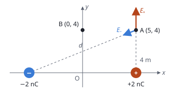

## Enunciado

Una partícula con carga $-2\ \mathrm{nC}$ está situada en el punto $(-5, 0)\ \mathrm{m}$ del plano $xy$. Otra partícula con carga $+2\ \mathrm{nC}$ está situada en el punto $(5, 0)\ \mathrm{m}$ del plano $xy$. Determine:

1. (1,5 puntos) El campo y el potencial eléctrico en el punto A$(5, 4)\ \mathrm{m}$ del plano $xy$.
2. (1 punto) El trabajo que realiza la fuerza del campo eléctrico al llevar una carga $q' = 3\ \mathrm{nC}$ desde A$(5, 4)\ \mathrm{m}$ hasta el punto B$(0, 4)\ \mathrm{m}$ del plano $xy$.

**Dato:** Constante de la ley de Coulomb, $K = 9\cdot 10^{9}\ \mathrm{N\,m^2\,C^{-2}}$.

## Datos

- $q_1 = -2\ \mathrm{nC} = -2\cdot 10^{-9}\ \mathrm{C}$ en $(-5, 0)\ \mathrm{m}$
- $q_2 = +2\ \mathrm{nC} = +2\cdot 10^{-9}\ \mathrm{C}$ en $(5, 0)\ \mathrm{m}$
- $q' = 3\ \mathrm{nC} = 3\cdot 10^{-9}\ \mathrm{C}$
- Distancias de las cargas al punto A:

$$d_1 = \sqrt{10^2 + 4^2} = 10{,}77\ \mathrm{m} \qquad d_2 = 4\ \mathrm{m}$$

## Planteamiento

El campo es un vector: se calcula el que crea cada carga en A, se descompone y se suman las componentes. La carga positiva está justo debajo de A, así que su campo es vertical y no hay que descomponerlo. El de la carga negativa apunta **hacia ella**, hacia abajo y a la izquierda.

El potencial es un escalar: se suman los valores con el signo de cada carga. Y el trabajo del campo sale de la diferencia de potencial entre los dos puntos, sin necesidad de conocer el camino.

## Resolución

### a) Campo y potencial en A

**Campo de la carga positiva.** Está a 4 m, en la vertical de A, y su campo se aleja de ella, hacia arriba:

$$\begin{aligned}
E_2 = K\,\frac{|q_2|}{d_2^2} &= \frac{9\cdot 10^{9}\cdot 2\cdot 10^{-9}}{4^2} \\[4pt]
    &= 1{,}125\ \mathrm{N\,C^{-1}}
\end{aligned}$$

$$\vec E_2 = 1{,}125\,\vec j\ \ \mathrm{N\,C^{-1}}$$

**Campo de la carga negativa.** Su módulo es:

$$\begin{aligned}
E_1 = K\,\frac{|q_1|}{d_1^2} &= \frac{9\cdot 10^{9}\cdot 2\cdot 10^{-9}}{116} \\[4pt]
    &= 0{,}155\ \mathrm{N\,C^{-1}}
\end{aligned}$$

Apunta de A hacia la carga. Para ir de A a la carga hay que moverse 10 m hacia la izquierda y 4 m hacia abajo, de modo que:

$$\cos\theta = \frac{10}{10{,}77} = 0{,}928$$

$$\operatorname{sen}\theta = \frac{4}{10{,}77} = 0{,}371$$

$$\begin{aligned}
\vec E_1 &= E_1\,(-\cos\theta\,\vec i - \operatorname{sen}\theta\,\vec j) \\[4pt]
         &= (-0{,}144\,\vec i - 0{,}058\,\vec j)\ \ \mathrm{N\,C^{-1}}
\end{aligned}$$

**Campo total.** Sumando componente a componente:

$$\begin{aligned}
\vec E &= \vec E_1 + \vec E_2 \\[4pt]
       &= (-0{,}144\,\vec i + 1{,}07\,\vec j)\ \ \mathrm{N\,C^{-1}}
\end{aligned}$$

Su módulo es $\sqrt{0{,}144^2 + 1{,}07^2} = 1{,}08\ \mathrm{N\,C^{-1}}$.

**Potencial.** Suma de los potenciales de las dos cargas, cada uno con su signo:

$$\begin{aligned}
V_A &= K\,\frac{q_1}{d_1} + K\,\frac{q_2}{d_2} \\[4pt]
    &= 9\cdot 10^{9}\left(\frac{-2\cdot 10^{-9}}{10{,}77} + \frac{2\cdot 10^{-9}}{4}\right) \\[4pt]
    &= 2{,}83\ \mathrm{V}
\end{aligned}$$

### b) Trabajo para llevar la carga de A a B

Hace falta el potencial en B$(0, 4)$. Ese punto está sobre el eje $y$, a la misma distancia de las dos cargas, y como las cargas son iguales y de signo contrario sus potenciales se anulan:

$$V_B = 0$$

El trabajo que hace el campo es:

$$\begin{aligned}
W_{A\to B} &= q'\,(V_A - V_B) \\[4pt]
           &= 3\cdot 10^{-9}\cdot (2{,}83 - 0) = 8{,}49\cdot 10^{-9}\ \mathrm{J}
\end{aligned}$$

Es positivo: la carga positiva $q'$ va de un punto de mayor potencial a otro de menor potencial, y el campo la lleva sin ayuda externa.

## Errores típicos

- Dibujar el campo de la carga negativa alejándose de ella. El campo **entra** en las cargas negativas.
- Sumar los módulos de los campos en lugar de los vectores.
- Olvidar el signo de la carga en el potencial, o poner la distancia al cuadrado.
- Calcular el trabajo con el campo y la distancia, $W = F\,d$: el campo no es uniforme. Se usa la diferencia de potencial.
- Escribir $W = q'(V_B - V_A)$. Ese es el trabajo de una fuerza externa, con el signo contrario.
