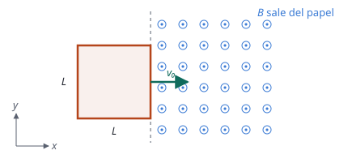

## Enunciado

Una espira cuadrada de lado $L = 20\ \mathrm{cm}$ está situada en el plano $xy$ y penetra en un campo magnético uniforme $\vec B = 200\ \mathrm{mT}\ \vec k$ con una velocidad uniforme $\vec v_0 = 2\ \mathrm{m\,s^{-1}}\ \vec i$ (ver figura). Si la espira está inicialmente completamente fuera del campo magnético y comienza a entrar en él en $t = 0$, determine:

1. (1 punto) El flujo magnético en $t_1 = 50\ \mathrm{ms}$ y $t_2 = 150\ \mathrm{ms}$.
2. (1 punto) La fem inducida en $t_1 = 50\ \mathrm{ms}$ y $t_2 = 150\ \mathrm{ms}$.
3. (0,5 puntos) La intensidad que recorre la espira en $t = 200\ \mathrm{ms}$ si su resistencia es de $15\ \Omega$.

## Datos

- Lado de la espira: $L = 20\ \mathrm{cm} = 0{,}20\ \mathrm{m}$
- Campo magnético: $B = 200\ \mathrm{mT} = 0{,}200\ \mathrm{T}$, perpendicular al plano de la espira
- Velocidad: $v_0 = 2\ \mathrm{m\,s^{-1}}$
- Resistencia: $R = 15\ \Omega$

## Planteamiento

Lo primero es saber **cuánto tarda la espira en entrar del todo**, porque el problema cambia en ese instante. Mientras entra, la superficie dentro del campo crece, el flujo aumenta y hay fem inducida. Cuando ya está toda dentro, el flujo deja de cambiar y la fem desaparece, aunque la espira siga moviéndose.

$$t_\text{entrada} = \frac{L}{v_0} = \frac{0{,}20}{2} = 0{,}10\ \mathrm{s} = 100\ \mathrm{ms}$$

Así que $t_1 = 50\ \mathrm{ms}$ corresponde a la espira entrando, y $t_2 = 150\ \mathrm{ms}$ y $t = 200\ \mathrm{ms}$ a la espira completamente dentro.

## Resolución

### a) Flujo magnético

El campo es perpendicular a la espira, así que el flujo es el producto del campo por la superficie que está dentro de él (tomamos la normal a la espira en el sentido de $\vec B$).

**Mientras entra** ($t < 100\ \mathrm{ms}$), la espira ha avanzado $x = v_0\,t$ dentro del campo y la superficie dentro es un rectángulo de lados $L$ y $x$:

$$\Phi(t) = B\,L\,v_0\,t$$

$$\Phi(t_1) = 0{,}200\cdot 0{,}20\cdot 2\cdot 0{,}050 = 4{,}00\cdot 10^{-3}\ \mathrm{Wb}$$

**Completamente dentro** ($t > 100\ \mathrm{ms}$), la superficie es la de toda la espira:

$$\Phi(t_2) = B\,L^2 = 0{,}200\cdot 0{,}20^2 = 8{,}00\cdot 10^{-3}\ \mathrm{Wb}$$

### b) Fem inducida

Por la ley de Faraday, la fem es la derivada del flujo cambiada de signo.

**Mientras entra**, el flujo crece linealmente con el tiempo:

$$\varepsilon = -\frac{\mathrm{d}\Phi}{\mathrm{d}t} = -B\,L\,v_0$$

$$\varepsilon(t_1) = -0{,}200\cdot 0{,}20\cdot 2 = -0{,}080\ \mathrm{V} = -80{,}0\ \mathrm{mV}$$

El signo depende del sentido que se haya elegido para la normal, y el enunciado no fija ninguno: el valor que importa es $80\ \mathrm{mV}$. El sentido de la corriente lo da la ley de Lenz. El flujo saliente está aumentando, así que la corriente inducida crea un campo entrante: circula en **sentido horario** vista desde arriba.

**Completamente dentro**, el flujo es constante y su derivada es cero:

$$\varepsilon(t_2) = 0$$

### c) Intensidad en t = 200 ms

En ese instante la espira lleva ya 100 ms completamente dentro del campo. El flujo no cambia, no hay fem y, por la ley de Ohm:

$$I = \frac{\varepsilon}{R} = \frac{0}{15} = 0$$

No circula corriente. Mientras la espira estaba entrando sí la había, de valor $0{,}080/15 = 5{,}3\cdot 10^{-3}\ \mathrm{A}$.

## Errores típicos

- Aplicar $\varepsilon = BLv$ en todos los instantes sin comprobar si la espira sigue entrando. Es la trampa del problema.
- Pensar que hay corriente siempre que la espira se mueve dentro de un campo. Lo que induce corriente es el **cambio** de flujo.
- Dejar el lado en centímetros o el campo en militeslas.
- Calcular el flujo en $t_2$ como $B\,L\,v_0\,t_2$: da una superficie mayor que la de la propia espira.
